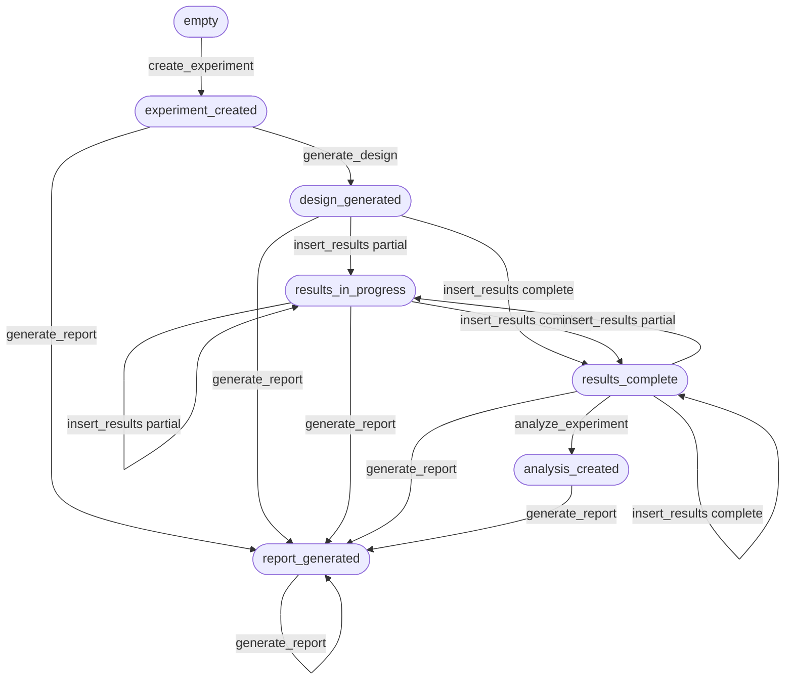

# Comprehensive Core Functionality Audit for DOE Toolkit GUI Planning

**Document Version:** 1.0  
**Date:** 2026-11-05  
**Codebase:** DOE Toolkit Python Core (`DOE_v1`)  
**Scope:** Core domain models, design generation, results handling, statistical analysis, reporting, workflow state architecture, CLI commands, and automated test coverage.  
**Purpose:** Pre-implementation baseline audit to guide the design and extension of the desktop GUI without making speculative assumptions.

---

## 1. Executive Summary

This technical audit provides an exhaustive, code-verified inspection of the DOE Toolkit codebase. The goal is to determine exactly which capabilities are currently implemented in the Python core, how they function, what limitations exist, and how they should be exposed in future GUI screens.

### 1.1 High-Level Architecture
The codebase is structured with clean separation of concerns:
- **Domain Models (`doe/models/`):** Pure Python dataclasses with self-contained validation, dictionary serialization (`to_dict`), and deserialization (`from_dict`).
- **Design Generators (`doe/designs/`):** Strategy-pattern generator interface with concrete generators for Full Factorial and Fractional Factorial designs, supported by shared utilities (`doe/designs/utils.py`).
- **Results Ingestion (`doe/result_input.py`, `doe/imports/`):** CSV import and in-memory merging of response measurements.
- **Statistical Engine (`doe/statistics/`, `doe/analysis_computation.py`):** Ordinary Least Squares (OLS) regression implemented from scratch using matrix algebra (with pure Python fallback or optional SciPy for p-values). Supports linear, interaction, and quadratic models.
- **Reporting (`doe/report_generation.py`):** Markdown formatted report generator summarizing the complete experimental lifecycle.
- **Workflow State Engine (`doe/models/workflow_state.py`):** Central state machine managing the linear experimental pipeline: `empty` &rarr; `experiment_created` &rarr; `design_generated` &rarr; `results_in_progress` / `results_complete` &rarr; `analysis_created` &rarr; `report_generated`.
- **Command-Line Interface (`doe/main.py`):** Argparse-based CLI driving workflow transitions via persistent JSON files.
- **Desktop GUI (`doe/gui/`):** PySide6 application currently featuring an active `ExperimentView` with dialogs, while `DesignView`, `ResultsView`, `AnalysisView`, and `ReportView` are placeholders awaiting implementation.

### 1.2 Status Summary of Major Functionalities

| Functional Area | Status | Verified Capabilities | Key Limitations & Constraints |
| :--- | :--- | :--- | :--- |
| **Design Generation** | **PARTIALLY IMPLEMENTED** | Full factorial and half-fraction factorial ($2^{k-1}$) generation; 2-level factor coding; continuous & categorical factors. | Continuous factors are strictly discretized to 2 levels (`[lower_bound, upper_bound]`). Randomization, replications, center points, and blocking exist in domain model schemas but are **not** supported by generators or CLI. |
| **Results Management** | **IMPLEMENTED** | Ingestion of complete and partial runs; CSV import; run ID & run number resolution; response validation; merging. | Import from CSV only; **no** CSV export. Only numeric response values accepted. |
| **Statistical Analysis** | **PARTIALLY IMPLEMENTED** | OLS regression for linear, pairwise interaction, and quadratic models; ANOVA table (Model, Residuals, Total); $R^2$, adjusted $R^2$, residuals, p-values. | **No plots or visualizations** in core. User cannot select terms or supply custom formulas. `analyze_experiment()` only evaluates the **first response** in multi-response experiments. Quadratic models cannot run on generated 2-level designs. 2-factor interaction models fail due to $N \le p$. |
| **Reporting** | **IMPLEMENTED** | Complete experimental Markdown report generation with formatted tables for overview, factors, responses, design matrix, results, coefficients, and ANOVA. | Output format is strictly limited to Markdown (`format="markdown"`). No PDF, HTML, DOCX, or chart embedding. |
| **Workflow & State** | **IMPLEMENTED** | Strict state machine with forward transitions, entity reference checks, audit trails, and JSON schema version 1.0/1.1 persistence. | Strictly single-entity pipeline (1 experiment, 1 design, 1 results, 1 analysis). No backward state transitions (editing upstream invalidates downstream). |
| **Desktop GUI** | **PARTIALLY IMPLEMENTED** | Main window, sidebar navigation, menu/toolbar, session file persistence, `ExperimentView` with factor and response dialogs. | Screens for Design, Results, Analysis, and Report are currently non-functional `PlaceholderView` widgets. |

---

## 2. Design Capabilities

### 2.1 Supported Design Types and Parameter Matrix

The core engine implements design generation via `doe/design_generation.py` using generators inheriting from `DesignGenerator` (`doe/designs/generator_interface.py`).

| Design Type Identifier | Display Name | Generator Class | Available Generator Parameters | Default Values | Validation Rules & Preconditions |
| :--- | :--- | :--- | :--- | :--- | :--- |
| `full_factorial` | Full Factorial Design | `FullFactorialGenerator` (`doe/designs/full_factorial.py`) | `experiment: Experiment` | None (takes experiment object) | &bull; Workflow step must be `experiment_created`.<br>&bull; Continuous factors must define numeric `lower_bound < upper_bound`.<br>&bull; Categorical factors must define $\ge 2$ unique levels.<br>&bull; Total runs = $2^{n_{\text{continuous}}} \times \prod |\text{levels}_j|$. |
| `fractional_factorial` | Fractional Factorial Design | `FractionalFactorialGenerator` (`doe/designs/fractional_factorial.py`) | `experiment: Experiment` | None (takes experiment object) | &bull; Workflow step must be `experiment_created`.<br>&bull; For $k \ge 3$ factors, generates a half-fraction ($2^{k-1}$) subset using parity of coded levels ($I = X_1 X_2 \dots X_k$).<br>&bull; For $k < 3$ factors, falls back to full factorial. |

> **Implementation Note on `generate_design()`:**  
> The orchestration function `generate_design(state: WorkflowState, design_type: str = "full_factorial") -> WorkflowState` (`doe/design_generation.py#L44-L102`) accepts **only** `state` and `design_type`. It does not accept parameters for randomization seeds, replications, center points, blocking, or custom generators.

### 2.2 Factor Handling and Discretization
1. **Continuous Factors (`type="continuous"`):**
   - Modeled in `Factor` (`doe/models/factor.py#L13-L83`).
   - Requires `lower_bound` and `upper_bound` as numeric (`int` or `float`) where `lower_bound < upper_bound`.
   - `levels` must be `None` (setting levels on continuous factors raises `DomainValidationError`).
   - **Discretization in Generators:** In both `FullFactorialGenerator` and `FractionalFactorialGenerator`, `_factor_levels()` (`doe/designs/utils.py#L21-L40`) discretizes continuous factors strictly into the two-element list `[lower_bound, upper_bound]`. Intermediate levels (e.g. center points or 3-level factorial grids) are **not generated**.
2. **Categorical Factors (`type="categorical"`):**
   - Modeled in `Factor` (`doe/models/factor.py`).
   - Requires `levels` to be a `list` containing at least 2 distinct items (numbers or strings).
   - `lower_bound` and `upper_bound` must be `None`.
   - In `FullFactorialGenerator`, all levels in `levels` are used in the Cartesian product.
   - In `FractionalFactorialGenerator`, level 0 is coded as `-1` and all other levels are coded as `+1`.

### 2.3 Factor Coding
- **Model:** `FactorCoding` (`doe/models/design.py#L150-L247`).
- **Supported Methods in Domain Model:** `"two_level"` and `"center_scale"`.
- **Automatic Generation:** `generate_factor_codings(experiment)` (`doe/designs/utils.py#L107-L139`):
  - Automatically creates a `"two_level"` coding mapping `str(lower_bound) -> -1.0` and `str(upper_bound) -> 1.0` for all continuous factors.
  - Automatically creates a `"two_level"` coding mapping `str(levels[0]) -> -1.0` and `str(levels[1]) -> 1.0` for categorical factors having **exactly 2 levels**.
  - Categorical factors with $>2$ levels do **not** receive factor coding entries (they are handled at analysis time via dummy/one-hot indicator columns).
- **Transformation / Evaluation:** `FactorCoding.code(value)`:
  - Exact string match lookup in `mapping`.
  - For continuous numeric values, performs linear interpolation/extrapolation based on the two mapping points:  
    $$\text{coded} = y_1 + \frac{y_2 - y_1}{x_2 - x_1} (x - x_1)$$

### 2.4 Experimental Run Generation
- Experimental runs are computed via Cartesian product using Python's `itertools.product(*level_lists)` in `generate_factorial_combinations()` (`doe/designs/utils.py#L42-L65`).
- Runs are instantiated as `Run` objects (`doe/models/design.py#L24-L96`) with:
  - `run_id`: Automatically generated UUID4 string.
  - `run_number`: 1-based integer index ($1, 2, \dots, N$).
  - `factor_values`: Dictionary mapping factor name &rarr; actual experimental level value.

### 2.5 Advanced Design Options: Domain Model vs. Generator Support

| Feature | Supported in Domain Model? | Supported in Design Generators? | Supported in CLI / GUI? | Details & Verification |
| :--- | :--- | :--- | :--- | :--- |
| **Randomization** | **YES** (`Design.randomization: bool`, `Design.order: Optional[List[str]]`) | **NO** | **NO** | `FullFactorialGenerator` and `FractionalFactorialGenerator` always instantiate `Design(..., randomization=False, order=None)`. The generator code has no shuffling mechanism. |
| **Replication** | **YES** (`Design.replications: Optional[int]`) | **NO** | **NO** | `replications` field is validated if present (`replications >= 1`), but neither generator accepts a replication count parameter or produces duplicate runs. |
| **Center Points** | **NO** | **NO** | **NO** | No center point parameter or generator logic exists. Continuous factors only evaluate at `[lower_bound, upper_bound]`. |
| **Blocking** | **YES** (`Block` model dataclass, `Design.blocks: List[Block]`) | **NO** | **NO** | `Block` (`doe/models/design.py#L103-L143`) validates run ID membership and uniqueness within a design, but no generator assigns runs to blocks. |
| **Resolution / Generators** | **NO** | **NO** | **NO** | Fractional factorial is fixed to half-fraction $2^{k-1}$ using a hardcoded parity rule on factor order. Custom generators (e.g. $2^{k-p}$ with custom defining relations or Plackett-Burman) are not implemented. |

### 2.6 Design Representation and Persistence
- A design is represented by the `Design` class (`doe/models/design.py#L252-L376`).
- It links to the experiment via `experiment_ref: str` (which must equal `Experiment.experiment_id`).
- It contains `runs: List[Run]`, `factor_coding: Optional[List[FactorCoding]]`, `blocks: List[Block]`, `design_type: str`, `randomization: bool`, `order: Optional[List[str]]`, and `schema_version: str = "1.1"`.
- Validated via `Design.validate(experiment: Experiment)`. For `full_factorial`, it strictly verifies that `len(runs) == expected_runs`, raising `RunCountMismatchError` if mismatched.
- Serialized to/from dictionary via `Design.to_dict()` and `Design.from_dict()`.

---

## 3. Results Capabilities

### 3.1 Data Structures and Association with Runs
Results are represented by two classes in `doe/models/results.py`:
1. **`ResultEntry` (`doe/models/results.py#L12-L53`):**
   - `run_ref: str`: References `Run.run_id`.
   - `values: Dict[str, Any]`: Mapping of response variable names to measured values (e.g. `{"yield": 84.5}`).
   - `status: str`: `"complete"` or `"partial"` (default `"complete"`).
   - `metadata: Optional[Dict[str, Any]]`.
2. **`Results` (`doe/models/results.py#L55-L120`):**
   - `results_id: str`: Identifier prefixed with `res_` (e.g. `res_a1b2c3d4`).
   - `design_ref: str`: References `Design.design_id`.
   - `entries: List[ResultEntry]`: List of run measurement records.
   - `completeness: str`: `"complete"` if all runs in the design have complete entries with all expected responses; otherwise `"partial"`.
   - `schema_version: str = "1.1"`.

### 3.2 Result Ingestion and Updating Workflow
The core workflow logic is implemented in `insert_results()` (`doe/result_input.py#L13-L139`):
1. **State Precondition:** The workflow state step must be one of `"design_generated"`, `"results_in_progress"`, or `"results_complete"`.
2. **Run Reference Resolution:**
   - Accepts technical `run_id` (UUID).
   - If `run_ref` matches an integer run number (e.g. `"1"` matching `Run.run_number == 1`), `insert_results` automatically resolves it to the underlying `run_id`.
   - Rejects unknown run references with `UnknownRunIdError`.
3. **Response Validation:**
   - Every key in `entry.values` must exist in `experiment.responses`. Extra keys raise `InvalidResponseValueError`.
   - Every value must be numeric (`int` or `float`, explicitly rejecting `bool`). Non-numeric values raise `InvalidResponseValueError`.
4. **Merging Behavior:**
   - If previous results already exist on the workflow state, existing entries are indexed by `run_ref` and updated in place or appended with new entries.
5. **Completeness Evaluation:**
   - Evaluates whether `len(all_entries) >= len(design.runs)` AND every run has an entry with `status == "complete"` containing all defined response variables.
   - If complete &rarr; sets `completeness = "complete"` and transitions workflow to `results_complete`.
   - If incomplete &rarr; sets `completeness = "partial"` and transitions workflow to `results_in_progress`.

### 3.3 CSV Import and Export
- **CSV Import (`doe/imports/csv_result_importer.py`):**
  - Function: `import_results_from_csv(source, design=None, responses=None) -> List[ResultEntry]`.
  - Header Requirements: Must contain a run identifier column (one of `"run_id"`, `"run_ref"`, `"run_number"`, or `"run_num"`) and at least one defined response column name.
  - Error Handling: Raises `CsvHeaderError` for missing headers or response columns; raises `CsvRowImportError` (with line number, field name, and invalid value) for malformed cells or unknown run references.
- **CSV Export:**
  - **NOT IMPLEMENTED.** There is no core function to export results or the combined design-and-results matrix back to CSV format.

---

## 4. Analysis Capabilities

### 4.1 Supported Statistical Methods
The statistical engine is implemented across `doe/statistics/` and invoked through `doe/analysis_computation.py`. All methods use Ordinary Least Squares (OLS) regression solved via the closed-form normal equations:
$$\hat{\beta} = (X^T X)^{-1} X^T Y$$
Matrix operations (transpose, multiplication, and Gauss-Jordan matrix inversion) are implemented in pure Python in `doe/statistics/linear_model.py`. P-values are calculated using `scipy.stats` if installed; otherwise, a standard normal error function (`math.erf`) fallback is used.

Three model types are implemented:
1. **`linear` (`doe/statistics/linear_model.py#L95-L297`):** Main effects only.
2. **`interaction` (`doe/statistics/interaction_model.py#L22-L224`):** Main effects plus all pairwise (2-way) interaction terms ($X_i \cdot X_j$).
3. **`quadratic` (`doe/statistics/quadratic_model.py#L21-L228`):** Main effects plus squared terms ($X_i^2$) for continuous factors.

### 4.2 Model Specification, Terms, and Formulas

| Model Type | Formula Representation | Included Model Terms | Parameter Count ($p$) | Example Formula (2 factors: `A`, `B`) |
| :--- | :--- | :--- | :--- | :--- |
| `linear` | `{response} ~ {terms}` | Intercept + all main effects | $1 + k$ (for $k$ continuous/coded factors) | `yield ~ A + B` |
| `interaction` | `{response} ~ {terms}` | Intercept + main effects + all 2-way interactions | $1 + k + \binom{k}{2}$ | `yield ~ A + B + A:B` |
| `quadratic` | `{response} ~ {terms}` | Intercept + main effects + squared terms ($X_i^2$) | $1 + 2k$ (for $k$ continuous factors) | `yield ~ A + B + A^2 + B^2` |

> **Critical Core Limitations in Model Specification:**
> 1. **No User Term Selection:** Terms are generated **automatically** by inspecting the experiment factors. Users cannot include or exclude specific terms.
> 2. **No Custom Formulas:** R-style model formula parsing (e.g. `yield ~ A + B + A:B` or `yield ~ (A + B)^2 - B`) is **not supported**.
> 3. **Higher-Order Terms Not Supported:** 3-way interactions ($A:B:C$) or higher polynomial powers ($A^3$) are not implemented.

### 4.3 Design Matrix $X$ Construction and Coding
For each run in `design.runs`, row vectors of $X$ are constructed as follows:
- **Column 0 (Intercept):** Always `1.0`.
- **Coded Factors:** If `design.is_factor_coded(factor.name)` is True, `design.get_coded_value(factor.name, run_value)` is called, mapping values to $[-1.0, +1.0]$.
- **Uncoded Continuous Factors:** Converted directly to float: `float(run_value)`.
- **Uncoded Categorical Factors:** Dummy (indicator) coded using the first level in `factor.levels[0]` as reference: creates columns for `factor.levels[1:]`, each having value `1.0` if matching, else `0.0`.
- **Interaction Terms:** In `fit_interaction_model()`, pairwise columns are calculated as $X_{t_1} \times X_{t_2}$.
- **Quadratic Terms:** In `fit_quadratic_model()`, squared columns are calculated as $(X_{\text{base}})^2$.

### 4.4 Degrees of Freedom, Rank Deficiency, and Estimability Bottlenecks

The code enforces that the number of observations $N$ must be **strictly greater** than the number of model parameters $p$:
```python
if N <= p:
    raise InsufficientObservationsError(f"Insufficient observations (N={N}) for ... model with p={p} parameters.")
```
If $(X^T X)$ is non-invertible, `_matrix_inverse()` raises `NonEstimableModelError`.

This leads to two major mathematical and architectural consequences:
1. **Interaction Model on 2-Factor Factorials Fails:**
   - A 2-factor full factorial design has $N = 4$ runs.
   - The interaction model has $p = 4$ terms (`Intercept`, `A`, `B`, `A:B`).
   - Because $N \le p$ ($4 \le 4$), `fit_interaction_model` raises `InsufficientObservationsError`. Because the current design generator cannot add replicates or center points, a 2-factor experiment generated via the toolkit **cannot be analyzed with the interaction model**.
2. **Quadratic Model on 2-Level Factorials Always Fails:**
   - Any continuous factor generated by `FullFactorialGenerator` or `FractionalFactorialGenerator` only has 2 levels: $\{-1, +1\}$.
   - In coded space, $(-1)^2 = 1$ and $(+1)^2 = 1$. The quadratic column is an exact duplicate of the Intercept column (`[1, 1, 1, 1]`).
   - Consequently, $(X^T X)$ is singular, and `fit_quadratic_model` raises `NonEstimableModelError: Design matrix X^T X is singular or rank-deficient for quadratic model. Ensure factors have at least 3 distinct levels to estimate quadratic terms.`
   - Therefore, **the quadratic model cannot run on any design generated by the current design generators.** It can only run on manually constructed custom designs loaded from external JSON files.

### 4.5 Statistical Metrics and Output Diagnostics
The resulting `Analysis` model (`doe/models/analysis.py`) contains:
- `model_type`: `"linear"`, `"interaction"`, or `"quadratic"`.
- `formula`: Model formula string (e.g. `yield ~ temp + pressure`).
- `terms`: List of term names (e.g. `["Intercept", "temp", "pressure"]`).
- `coefficients`: Dictionary of estimated $\hat{\beta}_j$ values rounded to 6 decimal places.
- `p_values`: Two-tailed t-test p-values for each coefficient based on $df_{\text{res}} = N - p$.
- `r_squared`: Coefficient of determination: $R^2 = 1 - \frac{SS_{\text{res}}}{SS_{\text{tot}}}$.
- `adjusted_r_squared`: $R^2_{\text{adj}} = 1 - \frac{MS_{\text{res}}}{MS_{\text{tot}}}$.
- `residuals`: Raw residual vector $e_i = Y_i - \hat{Y}_i$ for each observation.
- `anova_table`: List of 3 summary rows:
  - `"Model"`: $SS_{\text{model}} = SS_{\text{tot}} - SS_{\text{res}}$, $df = p - 1$, $MS_{\text{model}}$, $F$-statistic, $p$-value.
  - `"Residuals"`: $SS_{\text{res}}$, $df = N - p$, $MS_{\text{res}}$.
  - `"Total"`: $SS_{\text{tot}}$, $df = N - 1$.
  *(Note: Sequential or partial decomposition for individual factors like Type I/III SS is not implemented).*
- `diagnostics`: Dictionary containing `{"response_variable": name, "n_observations": N, "n_parameters": p}`.

### 4.6 Analysis Workflow Orchestration (`doe/analysis_computation.py`)
- Function: `analyze_experiment(state: WorkflowState, model_type: str = "linear") -> WorkflowState`.
- **Precondition:** `state.step` must be `"results_complete"`.
- **Single-Response Restriction:** In multi-response experiments, `analyze_experiment()` does **not** accept a `response_name` argument. It defaults to the first response (`experiment.responses[0].name`). Secondary responses cannot be analyzed through `analyze_experiment()` without calling lower-level statistical functions directly.
- **Single Analysis Storage:** `WorkflowState` has a single `analysis` slot. Running a second analysis replaces the existing one in memory.

---

## 5. Report Capabilities

### 5.1 Existing Report Generation Logic
Reporting is implemented in `doe/report_generation.py`:
- `format_markdown_report(state: WorkflowState) -> str`: Builds a complete GitHub-flavored Markdown report string.
- `generate_report(state: WorkflowState, output_path: Optional[str] = None, format: str = "markdown") -> WorkflowState`: Validates state, validates format, optionally writes to disk, and transitions workflow step to `"report_generated"`.

### 5.2 Content Included in Generated Reports
1. **Title and Overview Table:** Experiment name, Experiment ID, Design Type, Description, Schema Version, Current Workflow Step.
2. **Factors Table:** Factor name, type, unit, and bounds (`[lower, upper]`) or comma-separated levels.
3. **Response Variables Table:** Response name, type, unit.
4. **Experimental Design Table (if present):** Design ID, design type, total run count, randomization flag, and full design matrix table (`Run ID`, `Run Number`, factor columns).
5. **Experimental Results Table (if present):** Results ID, completeness, recorded count, and table of results (`Run Reference`, response values, `Status`).
6. **Statistical Analysis Table (if present):** Analysis ID, model type, $R^2$, adjusted $R^2$, estimated coefficients table with p-values, and 3-row ANOVA table.

### 5.3 Report Limitations and Missing Features
- **Formats:** Markdown is the **only** supported format. Passing `format="pdf"`, `format="html"`, or `format="docx"` immediately raises `DomainValidationError: Unsupported report format: '...'. Supported format is 'markdown'.`
- **Plots and Charts:** No plots or graphs are generated or referenced in the report.
- **Workflow Decoupling:** `generate_report()` can be called at any step after `experiment_created` (e.g. reporting just the design before collecting results). Missing sections are simply omitted cleanly from the generated document.

---

## 6. Workflow Architecture and Persistence

### 6.1 WorkflowState and Step Transitions
The workflow state machine is defined in `doe/models/workflow_state.py`:



### 6.2 Entity Linking and Referential Integrity
Each entity contains an explicit foreign key reference to its parent:
- `Design.experiment_ref == Experiment.experiment_id`
- `Results.design_ref == Design.design_id`
- `Analysis.experiment_ref == Experiment.experiment_id`
- `Analysis.design_ref == Design.design_id`
- `Analysis.results_ref == Results.results_id`

When validating the workflow state, references are cross-checked. A mismatch raises `InconsistentReferenceError`.

### 6.3 State Mutation and Downstream Invalidation Rules
1. **Strictly Forward Transitions:** `WorkflowState.transition_to()` enforces allowed forward transitions only. Attempting a backward transition (e.g. from `design_generated` back to `experiment_created`) raises `WorkflowStateMismatchError`.
2. **Upstream Invalidation:** If an experiment is re-created or modified:
   - In `ExperimentView` (`doe/gui/views/experiment_view.py#L424-L474`), modifying the experiment warns the user that downstream entities (`design`, `results`, `analysis`) will be discarded.
   - When confirmed, `create_experiment()` generates a new `WorkflowState(step="experiment_created")` with a new `experiment_id`. All downstream references become invalid and are reset to `None`.
3. **No Multi-Entity Branching in a Single File:**
   - `WorkflowState` holds exactly one `experiment`, one `design`, one `results`, and one `analysis`.
   - Associating multiple designs with the same experiment, or running multiple alternative analyses (e.g. comparing linear vs. interaction), requires saving separate workflow `.json` files to disk.

### 6.4 Serialization and Schema Versioning
- Serialization methods: `WorkflowState.to_dict()` and `WorkflowState.save_to_json(file_path)`.
- Deserialization methods: `WorkflowState.from_dict(data)` and `WorkflowState.load_from_json(file_path)`.
- **Supported Schema Versions:** `"1.0"` and `"1.1"` (verified in `load_from_json()`). Any other version raises `SchemaVersionMismatchError`.

---

## 7. CLI Functionality (`doe/main.py`)

The command-line interface provides 6 subcommands. Each command loads a workflow JSON file, invokes core business logic, and saves the updated state.

| CLI Command | Purpose | Input Arguments | Output Produced | Core Functions Invoked | Workflow Entities Modified / Created |
| :--- | :--- | :--- | :--- | :--- | :--- |
| `init-experiment` | Initialize a new experiment from factor CSV and response args | `--name` (str)<br>`--factors-csv` (path)<br>`--response` (repeatable `name:type[:unit]`)<br>`--description` (optional)<br>`--output` (path) | JSON file with state `experiment_created` | `parse_factors_csv()`<br>`map_rows_to_factors()`<br>`create_experiment()` | Creates `Experiment` and new `WorkflowState`. |
| `generate-design` | Generate design runs for an experiment | `--input` / `--state` (path)<br>`--design-type` (`full_factorial`, `fractional_factorial`)<br>`--output` (path) | JSON file with state `design_generated` | `WorkflowState.load_from_json()`<br>`generate_design()` | Creates `Design` containing generated `Run` objects and `FactorCoding`. |
| `insert-results` | Import measured response values from a CSV file | `--input` / `--state` (path)<br>`--csv` (path to results CSV)<br>`--output` (optional, defaults to state) | JSON file with state `results_in_progress` or `results_complete` | `import_results_from_csv()`<br>`insert_results()` | Creates or updates `Results` entity and its `ResultEntry` list. |
| `analyze` | Run regression modeling and ANOVA on complete results | `--input` / `--state` (path)<br>`--model-type` (`linear`, `interaction`, `quadratic`)<br>`--output` (optional) | JSON file with state `analysis_created` | `WorkflowState.load_from_json()`<br>`analyze_experiment()` | Creates `Analysis` entity with coefficients, ANOVA, residuals, and metrics. |
| `report` | Generate publication-ready Markdown report | `--input` / `--state` (path)<br>`--output` (path to `.md`)<br>`--format` (`markdown`)<br>`--state-output` (optional) | Markdown `.md` text report file | `WorkflowState.load_from_json()`<br>`generate_report()` | Updates workflow state step to `report_generated`. |
| `status` | Print text summary of workflow file to standard output | `--input` / `--state` (path) | Formatted text in terminal | `WorkflowState.load_from_json()` | None (read-only inspection). |

> **GUI Reusability Assessment:**  
> The future GUI should **not** invoke CLI subcommands as subprocesses. Instead, the GUI can directly import and invoke the identical underlying functions (`create_experiment`, `generate_design`, `insert_results`, `analyze_experiment`, `generate_report`, and `import_results_from_csv`) operating on `session.workflow_state`.

---

## 8. Test Coverage Audit

The automated test suite in `tests/` covers unit, workflow integration, and end-to-end scenarios.

| Test File | Focus Area | Tested Scenarios & Assertions | Verified Implementation Details & Constraints |
| :--- | :--- | :--- | :--- |
| `test_experiment.py`, `test_experiment_creation.py` | Experiment domain model & creation | Creation, unique factor names, unique response names, validation propagation. | Confirms factor and response requirements. |
| `test_factor.py` | Factor domain model | Continuous bounds validation (`lower < upper`), categorical levels validation ($\ge 2$ unique values). | Enforces numeric bounds for continuous; list of $\ge 2$ levels for categorical. |
| `test_response.py` | Response domain model | Name and continuous type validation. | Verifies `type="continuous"` is strictly required. |
| `test_design.py`, `test_design_generation.py` | Design domain model & generation | Validation of runs, run IDs uniqueness, run count matching for full factorial, state transition. | Verifies full factorial run count formula ($2^c \cdot \prod l_j$). |
| `test_full_factorial.py` | Full factorial generator | `_factor_levels`, Cartesian product combinations, unique run IDs, factor values integrity. | Confirms continuous factors only evaluated at lower/upper bounds. |
| `test_design_utils.py` | Factor coding & fractional generator | Two-level factor coding mapping, interpolation/extrapolation, half-fraction generation ($2^{k-1}$). | Confirms 2-level coding logic and parity subset rule for fractional factorial. |
| `test_block.py` | Block domain model | Block ID uniqueness, run ID membership validation, block serialization roundtrip. | Confirms `Block` model is fully functional in isolation, but unused by generators. |
| `test_run.py` | Run domain model | Run validation against factor bounds and categorical levels. | Enforces strict validation of factor values. |
| `test_results.py`, `test_result_input.py` | Results model & insertion | Complete vs partial results, unknown run ID rejection, response type validation, merging. | Confirms automatic resolution of `run_number` to `run_id`. |
| `test_csv_result_importer.py` | CSV result import | Header validation, column mapping, numeric conversion, row error reporting. | Verifies error reporting with row number and invalid value. |
| `test_csv_parser.py`, `test_csv_mapping.py` | CSV factor import | Factor CSV parsing, bounds/levels conversion, JSON metadata parsing. | Confirms parsing format for factor tables. |
| `test_analysis_computation.py` | Linear regression & ANOVA | Benchmark OLS calculations, singular matrix detection, insufficient observations handling, categorical dummy coding. | Confirms $N \le p$ checks and singular matrix detection. |
| `test_analysis_model.py` | Analysis domain model | Validation of $R^2$, adjusted $R^2$, model types, serialization. | Confirms bounds checks for metrics ($0 \le R^2 \le 1$). |
| `test_coded_analysis.py` | Coded regression & higher models | Coded linear, interaction, and quadratic models on hand-crafted custom designs. | Highlights requirement for center points and $\ge 3$ levels for quadratic models. |
| `test_report_generation.py`, `test_report_workflow.py` | Report generation | Markdown formatting, section generation, format validation, workflow step transition. | Confirms Markdown formatting and rejection of non-markdown formats. |
| `test_workflow_state.py`, `test_persistence.py` | Workflow state machine | Step transitions, forward-only transition enforcement, JSON serialization/deserialization, audit history. | Verifies backward transition rejection. |
| `test_cli.py`, `test_cli_completion.py`, `test_cli_results.py` | CLI interface | Command-line argument parsing, exit codes, file input/output handling. | Confirms CLI subcommands end-to-end. |
| `test_e2e_full_workflow.py` | Complete lifecycle E2E | Programmatic API lifecycle (Steps 1&ndash;10) and CLI lifecycle (Steps 1&ndash;6). | Validates complete chain from factor CSV to report Markdown. |

---

## 9. Missing Features and Core Limitations

The following comprehensive list catalogs features that are either **PARTIALLY IMPLEMENTED** or **NOT IMPLEMENTED** in the core codebase:

### 9.1 Design Limitations
1. **No Design Replications:** While `Design.replications` exists in the model schema, neither generator implements replication logic.
2. **No Randomization of Runs:** While `Design.randomization` and `Design.order` exist in the model schema, generators do not randomize run sequences.
3. **No Center Points:** Generators cannot insert center points ($[0, 0, \dots, 0]$ in coded coordinates).
4. **No Blocking Generation:** Generators do not partition runs into blocks.
5. **No Response Surface Designs (RSM):** Central Composite Designs (CCD) and Box-Behnken designs are not implemented.
6. **No General Fractional Factorials:** Fractional factorials are limited to fixed half-fractions ($2^{k-1}$). Quarter-fractions ($2^{k-2}$), custom resolution specifications, or minimum aberration generators are not implemented.
7. **Continuous Factors Restricted to 2 Levels:** In design generation, continuous factors cannot have 3 or more levels.

### 9.2 Results Limitations
1. **No Results CSV Export:** Cannot export a design template CSV or results CSV from the core.
2. **Strictly Numeric Responses:** Categorical or qualitative responses are rejected.
3. **No Run Exclusion / Masking:** Outliers or aborted runs cannot be marked as excluded from analysis without deleting the entry.

### 9.3 Analysis Limitations
1. **No Visualizations or Plots:** The core has **zero plotting capabilities**. No Pareto charts, half-normal probability plots, main effects plots, interaction plots, contour plots, or residual diagnostic plots exist.
2. **Single Response Limitation in Workflow:** `analyze_experiment()` only evaluates `experiment.responses[0]`. Secondary responses in multi-response experiments are ignored by the standard workflow function.
3. **Quadratic Model Incompatibility:** Cannot run quadratic regression on any design generated by the toolkit because generated continuous factors only have 2 distinct levels, causing singular matrix inversion.
4. **2-Factor Interaction Model Incompatibility:** Cannot run interaction regression on 2-factor designs because $N = 4 \le p = 4$, violating degrees of freedom checks.
5. **No Model Term Customization:** Users cannot pick and choose specific model terms, omit insignificant terms, or write custom formulas.
6. **No Sequential ANOVA:** Only a 3-row global ANOVA table is produced; individual factor/term Sum of Squares (Type I / Type III) are not calculated.

### 9.4 Report Limitations
1. **Markdown Only:** No PDF, HTML, or DOCX export formats are supported.
2. **No Image / Plot Embedding:** Reports cannot embed graphical diagnostics.

### 9.5 Workflow Limitations
1. **Linear Pipeline Only:** Single experiment, single design, single results, and single analysis per workflow state.
2. **No Multi-Model Comparisons:** Cannot store or compare multiple model fits (e.g. Linear vs. Interaction) in the same workflow state file.
3. **No Backward Navigation in State:** State transitions cannot move backwards; modifying an experiment requires resetting downstream data.

---

## 10. Implications for the Future GUI

Based strictly on the verified capabilities and identified limitations of the Python core, the future GUI screens should be designed and extended as follows:

### 10.1 Design Screen (`DesignView`)
- **Supported Controls:**
  - Design Type Selector: A combo box offering **only** `"Full Factorial"` and `"Fractional Factorial"`.
  - Info / Run Count Banner: Dynamically compute and display the expected number of runs before generation ($2^{n_{\text{cont}}} \cdot \prod |\text{levels}|$ for full factorial; $2^{k-1}$ for fractional factorial if $k \ge 3$).
  - Generate Button: Calls `generate_design(session.workflow_state, design_type=selected_type)`.
  - Design Matrix Table: Displays generated runs (`Run Number`, `Run ID`, and factor columns with experimental values).
  - Coded Levels Table: A toggleable tab or view displaying the factor coding mapping (e.g. `100.0 -> -1.0`, `200.0 -> +1.0`).
- **Controls to Exclude / Disable:**
  - Do **not** offer options for Central Composite, Box-Behnken, Plackett-Burman, or General Fractional ($2^{k-p}$) until generator algorithms are implemented.
  - Do **not** expose active controls for Replications, Center Points, or Randomization unless explicitly documented as unsupported by the current generator.
  - If Replications or Randomization checkboxes are displayed for future planning, they must be disabled or flagged with tooltips indicating generator limitations.

### 10.2 Results Screen (`ResultsView`)
- **Supported Controls:**
  - Interactive Results Table: Displaying `Run Number`, factor levels (read-only), and editable cells for each response variable.
  - Import CSV Button: File dialog to select a results CSV, invoking `import_results_from_csv()` and passing parsed entries to `insert_results()`.
  - Manual Entry / Save Results Button: Collects table entries, validates numbers, and calls `insert_results(session.workflow_state, entries)`.
  - Completeness Indicator: Visual badge showing `"Complete"` (green) or `"Partial (In Progress)"` (amber), displaying recorded runs vs total runs.
- **Controls to Add for Usability (GUI-Level Helpers):**
  - "Export Template CSV": Even though the core lacks CSV export, the GUI can easily serialize the design runs table (`run_number,run_id,yield,...`) to a template CSV file for the user to fill out.
  - Clear Results Button: Resets entered results to allow re-entry.

### 10.3 Analysis Screen (`AnalysisView`)
- **Supported Controls:**
  - Response Variable Selector: A combo box listing all responses defined in the experiment, allowing the user to select which response to analyze (addressing the core's default to only the first response).
  - Model Type Selector: A combo box offering `"Linear"`, `"Interaction (2-Way)"`, and `"Quadratic"`.
  - **Model Eligibility Guardrails / Warnings:**
    - If the user selects `"Quadratic"` on a design with only 2 levels per factor: Show an informative inline warning: *"Quadratic models require at least 3 levels per continuous factor (such as center points). Fitting will result in a singular matrix error."* Disable the Run Analysis button or warn before execution.
    - If the user selects `"Interaction"` on a 2-factor full factorial design ($N=4$): Show an inline warning: *"Interaction model requires more observations than parameters ($N > 4$). Fitting will result in insufficient observations error."*
  - Run Analysis Button: Executes the selected statistical model on the chosen response.
  - Results Tabs / Display:
    - Summary Tab: Displaying formula, $R^2$, adjusted $R^2$, number of observations, and parameter count.
    - Coefficients Table: Displaying Term, Estimate ($\hat{\beta}_j$), Standard Error, t-statistic, and p-value (with formatting for significance, e.g. bolding $p < 0.05$).
    - ANOVA Table: Displaying Model, Residuals, Total rows with Sum of Squares, DF, Mean Squares, F-value, and p-value.
    - Residuals Table: Displaying Run Number, Measured $Y$, Predicted $\hat{Y}$, and Residual $e_i$.
- **Plotting Strategy for GUI:**
  - Because the core contains **no plotting libraries**, plotting should **not** be expected from the core engine.
  - If visual plots (Pareto chart of effects, predicted vs. actual, residuals vs. run) are desired in the GUI, they must either be rendered using PySide6's native graphics view / Qt Charts, or by adding `matplotlib` as an optional GUI dependency.

### 10.4 Report Screen (`ReportView`)
- **Supported Controls:**
  - Report Preview Area: A read-only rich text / Markdown viewer displaying the output of `format_markdown_report(session.workflow_state)`.
  - Generate / Export Button: Prompts for destination file (`.md`) and calls `generate_report(session.workflow_state, output_path=path, format="markdown")`.
  - Format Selector: Fixed to `"Markdown (.md)"` (disable or omit PDF/HTML until export converters are added).

### 10.5 Workflow Navigation and Session Synchronization
- **Sidebar Status:** Ensure the sidebar status label accurately reflects all 7 workflow states (`Empty`, `Experiment Created`, `Design Generated`, `Results In Progress`, `Results Complete`, `Analysis Created`, `Report Generated`).
- **Dirty State Tracking:** Any generation or data insertion (`generate_design`, `insert_results`, `analyze_experiment`) must mark `session.is_dirty = True` and trigger window title updates with the `*` dirty indicator.
- **Upstream Change Warning:** Navigating back to `ExperimentView` and modifying factors or responses must warn the user before calling `create_experiment()` that downstream data (`design`, `results`, `analysis`) will be reset.

