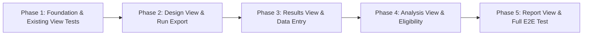

# DOE Toolkit GUI Implementation Plan: Complete Desktop Roadmap

**Document Version:** 2.0  
**Date:** 2026-11-18  
**Target Application:** Desktop Graphical User Interface (PySide6) for DOE Toolkit (`DOE_v1`)  
**Baseline Reference:** Core Functionality Audit ([docs/core_functionality_audit.md](file:///c:/Users/marti/Documents/DOE_v1/docs/core_functionality_audit.md))  
**Status:** Living Architectural Blueprint & Implementation Plan

---

## 1. Document Overview & Baseline Verification

### 1.1 Objective
This document defines the complete technical roadmap for implementing the graphical user interface (GUI) of the DOE Toolkit. The ultimate objective is to enable an external user to perform the complete, currently supported Design of Experiments (DOE) lifecycle entirely through a desktop GUI, without using the command-line interface (CLI) or terminal scripts.

### 1.2 Authoritative Baseline Verification
The comprehensive core functionality audit located at [docs/core_functionality_audit.md](file:///c:/Users/marti/Documents/DOE_v1/docs/core_functionality_audit.md) was inspected and remains **100% valid as the authoritative baseline**. A targeted repository check confirmed:
- **Core Domain & Workflow Models:** No changes have occurred to `doe/models/`, `doe/designs/`, `doe/statistics/`, `doe/imports/`, or `doe/main.py` since the audit.
- **Workflow State & Persistence:** The single-entity pipeline and JSON serialization schema (`v1.0` / `v1.1`) remain unchanged.
- **Existing GUI Scaffold:** The current GUI implementation consists of the application bootstrap (`doe/gui/app.py`), the session controller (`doe/gui/session.py`), the main window frame (`doe/gui/main_window.py`), the functional experiment view (`doe/gui/views/experiment_view.py`), dialogs (`factor_dialog.py`, `response_dialog.py`), and four non-functional placeholder views (`placeholder_view.py`).
- **Dependencies:** `requirements.txt` specifies `PySide6>=6.5.0` and `pytest>=7.0.0`. No third-party plotting or Excel export libraries are currently included.

### 1.3 Identified Discrepancies from Initial GUI Scaffold
1. **Missing GUI Test Suite:** The initial plan (`specs/gui_plan.md` v1.0) outlined `tests/test_gui.py`, but no GUI tests currently exist in `tests/`. Offscreen headless GUI testing must be introduced in Phase 1.
2. **Export Capabilities:** The core provides CSV import for factors and results, but **no export functions** (CSV or Excel) for the generated design matrix or blank results templates.
3. **Response Selection in Analysis:** In `doe/analysis_computation.py#L25-L68`, `analyze_experiment()` does not accept a `response_name` argument and defaults to `experiment.responses[0].name`. This prevents multi-response experiments from analyzing any response other than the first through the standard workflow entry point.

---

## 2. Core GUI Architecture & Design Principles

```
┌─────────────────────────────────────────────────────────────────────────────┐
│                             MainWindow (PySide6)                            │
├───────────────┬─────────────────────────────────────────────────────────────┤
│   Sidebar     │                      QStackedWidget                         │
│ ┌───────────┐ │ ┌─────────────────────────────────────────────────────────┐ │
│ │Experiment │ │ │ Index 0: ExperimentView (Factors, Responses, Metadata)  │ │
│ │Design     │ │ │ Index 1: DesignView     (Strategy, Run Matrix, Coded)   │ │
│ │Results    │ │ │ Index 2: ResultsView    (Response Input, Import CSV)    │ │
│ │Analysis   │ │ │ Index 3: AnalysisView   (OLS, ANOVA, Diagnostics)       │ │
│ │Report     │ │ │ Index 4: ReportView     (Markdown Preview, Export)      │ │
│ ├───────────┤ │ └─────────────────────────────────────────────────────────┘ │
│ │Workflow   │ ├─────────────────────────────────────────────────────────────┤
│ │State:     │ │                      GuiSession                             │
│ │[Step Name]│ │  - workflow_state: WorkflowState                            │
│ └───────────┘ │  - current_file_path: Optional[str], is_dirty: bool         │
└───────────────┴─────────────────────────────────────────────────────────────┘
                                       │ Direct Python API calls
                                       ▼ (No CLI subprocesses)
┌─────────────────────────────────────────────────────────────────────────────┐
│                                DOE Python Core                              │
│  create_experiment() ─► generate_design() ─► insert_results() ─►            │
│  analyze_experiment() ─► generate_report() ─► WorkflowState JSON            │
└─────────────────────────────────────────────────────────────────────────────┘
```

### 2.1 Architectural Rules
1. **Direct Core Integration (No CLI Subprocesses):** The GUI must import and call the underlying Python core functions directly (`create_experiment`, `generate_design`, `insert_results`, `analyze_experiment`, `generate_report`, and `import_results_from_csv`). No shell execution, subprocess spawning, or terminal output parsing is permitted.
2. **Strict Separation of Concerns:**
   - **View Layer (`doe/gui/views/`):** Owns UI layouts, table models, widget state, input validation feedback, and file dialog prompts.
   - **Session Layer (`doe/gui/session.py`):** Owns active state lifecycle, file path association, and dirty tracking.
   - **Core Engine (`doe/`):** Owns scientific rules, factor coding transformations, OLS normal equation solutions, and JSON serialization.
3. **Single Experiment Workflow Contract:** A single workflow JSON represents exactly one experiment and its associated design, results, and analysis. The GUI will not introduce multi-experiment project hierarchies or speculative tabbed multi-project architectures.
4. **Honest Capability Exposure:** Features not supported by the core (e.g. 3-level continuous factorials, response surface designs, center points, run randomization, higher-order interactions, PDF export) must never be presented as functional or silently approximated. Unsupported controls must be excluded or disabled with informative tooltips.

---

## 3. Specifications for the Five Application Sections

---

### 3.1 Section 1: Experiment (`ExperimentView`)

#### 3.1.1 Purpose & Responsibilities
Provides the entry point for configuring a new or existing experiment. Allows the user to define experiment metadata (Name, Description), manage experimental factors (continuous bounds or categorical levels), configure response variables, and instantiate a validated `WorkflowState(step="experiment_created")`.

#### 3.1.2 Information Displayed
- **Experiment Metadata Group:**
  - Name (mandatory `QLineEdit` with required indicator).
  - Description (optional `QTextEdit`, maximum height 80px).
- **Factors Management Group:**
  - Toolbar buttons: `Add Factor`, `Edit Factor`, `Remove Factor`.
  - Factors Summary Table: Columns: `Name`, `Type` (Continuous / Categorical), `Details` (`[lower, upper]` for continuous; comma-separated levels for categorical), `Unit`.
- **Responses Management Group:**
  - Toolbar buttons: `Add Response`, `Edit Response`, `Remove Response`.
  - Responses Summary Table: Columns: `Name`, `Type` (Continuous), `Unit`.
- **Creation Control:**
  - `Create Experiment` / `Apply Changes` primary action button.
- **Created Experiment Summary Box:**
  - Rich-text overview of the active experiment (visible once created/loaded).

#### 3.1.3 Available User Interactions
- Add continuous factor with lower and upper numeric bounds (`FactorDialog`).
- Add categorical factor with $\ge 2$ unique levels (`FactorDialog`).
- Edit selected factor (double-click row or click `Edit Factor`).
- Remove selected factor (with confirmation dialog).
- Add/Edit/Remove response variable (`ResponseDialog`).
- Click `Create Experiment` to commit changes into `session.workflow_state`.

#### 3.1.4 Core Integration
- **Function Called:** `doe.experiment_creation.create_experiment(name, factors, responses, description) -> WorkflowState`.
- **Preconditions Checked:** Name must be non-empty string; factors list must contain $\ge 1$ `Factor`; responses list must contain $\ge 1$ `Response`.
- **Exceptions Caught & Surfaced:** `DomainValidationError`, `InvalidFactorTypeError`, `InvalidFactorBoundsError`, `MissingFactorLevelsError`, `DuplicateFactorNameError`, `DuplicateFactorLevelsError`, `MissingResponseError`, `InvalidResponseTypeError`. Displayed via `QMessageBox.warning`.

#### 3.1.5 Upstream Invalidation Behavior
- Modifying and re-applying experiment settings when downstream entities exist (`state.design is not None` or `state.results is not None` or `state.analysis is not None`) triggers an explicit confirmation dialog:  
  *"Modifying the experiment definition will reset the current design, results, and analysis. Do you wish to proceed?"*
- Upon confirmation, a fresh `WorkflowState(step="experiment_created")` is produced with a new `experiment_id`, cleanly resetting downstream data.

---

### 3.2 Section 2: Design (`DesignView`)

#### 3.2.1 Purpose & Responsibilities
Allows the user to select an eligible experimental design strategy, calculate and review the expected run count, generate the experimental design matrix using the core generator, inspect the generated runs in both experimental and coded units, and export the design to CSV or Excel for laboratory execution.

#### 3.2.2 Information Displayed
- **Experiment Context Card:**
  - Displays Experiment Name, Number of Factors, and Number of Responses.
- **Design Strategy Configuration Group:**
  - **Design Type Selector (`QComboBox`):**
    - `Full Factorial (2-level / multi-level categorical)` [Supported]
    - `Fractional Factorial (Half-Fraction 2^(k-1))` [Supported for $k \ge 3$]
  - **Run Count Calculator Banner (`QFrame`):**
    - Dynamically computes and displays the expected run count before generation:
      $$\text{Full Factorial Runs} = 2^{n_{\text{continuous}}} \times \prod_{j=1}^{m} |\text{levels}_j|$$
      $$\text{Fractional Factorial Runs} = 2^{k-1} \quad (\text{for } k \ge 3)$$
    - Shows an informative note when fractional factorial falls back to full factorial ($k < 3$).
  - **Generation Action Button:**
    - `Generate Design` (primary button, enabled when `session.step == "experiment_created"` or when re-generating).
- **Generated Design Inspection Group (Tabbed Widget):**
  - **Tab 1: Experimental Run Matrix (`QTableWidget`):**
    - Columns: `Run Number`, `Run ID` (UUID preview/tooltip), followed by columns for each factor showing actual experimental values (e.g. `100.0 °C`, `Ethanol`).
  - **Tab 2: Coded Factor Matrix (`QTableWidget`):**
    - Displays coded transformation levels ($-1.0$, $+1.0$) for continuous factors and 2-level categorical factors, demonstrating how the core engine translates settings into normalized space.
  - **Tab 3: Design Metadata:**
    - Design ID, Design Type, Total Runs, Randomization status (`False`), Blocks (`None`).
- **Design Export Toolbar:**
  - `Export Design to CSV...` button.
  - `Export Design to Excel...` button.

#### 3.2.3 Available User Interactions
- Switch design type in dropdown and observe dynamic run count updates.
- Click `Generate Design` to execute generation.
- Toggle between Experimental Run Matrix and Coded Matrix tabs.
- Click `Export Design to CSV...` to open a `QFileDialog.getSaveFileName()` and export the run table.
- Click `Export Design to Excel...` to export the run table to spreadsheet format.

#### 3.2.4 Core Integration
- **Function Called:** `doe.design_generation.generate_design(session.workflow_state, design_type=selected_type) -> WorkflowState`.
- **Preconditions Checked:** `session.step == "experiment_created"`.
- **Design Inspection:** Reads `session.workflow_state.design.runs`, `design.design_id`, `design.factor_coding`.
- **Export Operation:** Must read directly from `session.workflow_state.design.runs`. **Must NOT regenerate the design.**

#### 3.2.5 Core Modifications Required & Export Strategy
1. **Export Design to CSV:**  
   Implement a reusable core utility in `doe/designs/utils.py` (or a dedicated `doe/exports/csv_export.py`):
   ```python
   def export_design_to_csv(design: Design, experiment: Experiment, file_path: str) -> None:
       """Exports the exact runs stored in Design to a user-facing CSV."""
   ```
   Headers: `Run Number,Run ID,<Factor_1>,<Factor_2>,...` followed by actual factor values per run.
2. **Export Design to Excel:**
   - *Option A (Recommended for standard compliance):* Add `openpyxl>=3.1.0` to `requirements.txt` and provide `export_design_to_excel(design, experiment, file_path)`.
   - *Option B (Zero new dependencies):* Export as an XML Spreadsheet 2003 (`.xml`) or formatted TSV with `.xls` extension.
   *Decision:* Option A provides true native `.xlsx` files expected by laboratory users. If dependencies must remain strictly unchanged, Option B or CSV-only export is used.

#### 3.2.6 Handling Unsupported Features in GUI
- **Center Points, Replications, Randomization, Blocking:** The audit verified that these domain attributes exist in `doe/models/design.py` but are not implemented in generators. The GUI **must not** offer active checkboxes for randomization or center points. An expandable "Advanced Design Options (Future Roadmap)" panel may display these controls disabled with tooltips (e.g. *"Replication and center point generation will be introduced in a future release"*).

#### 3.2.7 Upstream Invalidation Behavior
- Regenerating a design when results or analysis exist triggers a confirmation warning:  
  *"Regenerating the design will discard existing experimental results and statistical analysis. Do you wish to continue?"*
- On confirmation, the state transitions to `design_generated`, clearing `results` and `analysis`.

---

### 3.3 Section 3: Results (`ResultsView`)

#### 3.3.1 Purpose & Responsibilities
Provides data entry and ingestion for experimental response measurements. Enables manual recording directly into an interactive run table, bulk import from CSV files, verification of response values, tracking of result completeness, and generation of a blank results recording template.

#### 3.3.2 Information Displayed
- **Status & Completeness Header:**
  - Status Badge: `"Results Complete"` (green) or `"Results In Progress (Partial)"` (amber).
  - Measurement Counter: `"Recorded: X / N runs | Missing: Y measurements"`.
  - Design reference banner indicating the active Design ID.
- **Results Management Toolbar:**
  - `Export Results Template (CSV)...` button.
  - `Import Results from CSV...` button.
  - `Save / Commit Results` button.
  - `Clear Results` button.
- **Interactive Results Table (`QTableWidget`):**
  - **Context Columns (Read-Only, grey background):**
    - `Run Number`
    - Factor 1, Factor 2, ... (actual experimental values to guide the operator).
  - **Measurement Columns (Editable):**
    - Response 1, Response 2, ... (cells for entering numeric values).
  - **Status Column (Read-Only):**
    - Visual indicator per row: `Complete` (checkmark) or `Pending` (amber dash).
- **Validation Message Area (`QLabel`):**
  - Highlights specific invalid cells (e.g. non-numeric input in Row 3).

#### 3.3.3 Available User Interactions
- Edit response cells directly in the table.
- Click `Export Results Template (CSV)...` to create a blank CSV template with columns: `run_number`, `run_id`, factor columns, and empty response headers.
- Click `Import Results from CSV...` to select an external results CSV file, parse entries via `import_results_from_csv()`, populate the table, and update the workflow state.
- Click `Save / Commit Results` to validate and commit manual entries to `session.workflow_state`.
- Click `Clear Results` to wipe entered measurements after confirmation.

#### 3.3.4 Core Integration
- **CSV Import:** `doe.imports.csv_result_importer.import_results_from_csv(source, design=design, responses=responses) -> List[ResultEntry]`.
- **Results Insertion & Merging:** `doe.result_input.insert_results(session.workflow_state, result_entries) -> WorkflowState`.
- **Completeness State Logic:**
  - If all runs have complete numeric responses &rarr; state transitions to `results_complete`.
  - If some runs or responses are missing &rarr; state transitions to `results_in_progress`.

#### 3.3.5 Core Modifications Required
- **Results Template CSV Export:**  
  Add `export_results_template_csv(design: Design, experiment: Experiment, file_path: str) -> None` to `doe/result_input.py` or `doe/imports/`. This utility writes out the run numbers, run IDs, factor levels, and empty columns for defined response variables.

#### 3.3.6 Error Handling & Validation
- **Numeric Enforcement:** Table delegates or cell validators enforce that only valid floating-point numbers can be committed.
- **CSV Import Errors:** Catches `CsvHeaderError` and `CsvRowImportError`. Surfaces row number, column name, and invalid value via a detailed `QMessageBox.critical`.

---

### 3.4 Section 4: Analysis (`AnalysisView`)

#### 3.4.1 Purpose & Responsibilities
Provides statistical model selection, eligibility verification, execution of Ordinary Least Squares regression and ANOVA, and structured presentation of statistical metrics ($R^2$, adjusted $R^2$, coefficients, t-test p-values, ANOVA table, and residuals).

#### 3.4.2 Information Displayed
- **Model Configuration Panel:**
  - **Response Variable Selector (`QComboBox`):** Lists all defined responses in `experiment.responses`. Allows multi-response experiments to analyze any response.
  - **Model Type Selector (`QComboBox`):**
    - `Linear Model (Main Effects)`
    - `Interaction Model (Main Effects + 2-Way Interactions)`
    - `Quadratic Model (Main Effects + Squared Terms)`
  - **Model Terms Formula Preview (`QLabel`):**
    - Dynamically displays the mathematical formula of the selected model (e.g. `yield ~ 1 + temp + pressure + temp:pressure`).
  - **Model Eligibility & Estimability Banner (`QFrame`):**
    - Displays an active diagnostic indicator before execution:
      - *Green Checkmark:* Model is estimable with current design and data ($N > p$, $X^T X$ full rank).
      - *Red Warning / Blocker:* Model cannot be estimated, detailing the exact mathematical reason (e.g. *"Quadratic terms require $\ge 3$ distinct levels per factor. The current design has only 2 levels."* or *"Interaction model requires $N > 4$ runs for 2 factors (current $N=4$)."*).
  - **Execution Action Button:**
    - `Run Analysis` button (enabled only when state is `results_complete` and model is estimable).
- **Statistical Results Presentation (Tabbed Widget):**
  - **Tab 1: Model Summary Cards (`QFrame`):**
    - $R^2$ (Coefficient of Determination).
    - Adjusted $R^2$.
    - Number of Observations ($N$).
    - Number of Model Parameters ($p$).
    - Residual Degrees of Freedom ($df_{\text{res}} = N - p$).
  - **Tab 2: Coefficients Table (`QTableWidget`):**
    - Columns: `Term`, `Estimate` ($\hat{\beta}_j$), `Std Error` ($s.e.$), `t-Statistic`, `p-Value`, `Significance` ($p < 0.05$ flagged/bolded).
  - **Tab 3: ANOVA Table (`QTableWidget`):**
    - Columns: `Source`, `Sum of Squares (SS)`, `df`, `Mean Square (MS)`, `F-Value`, `p-Value`.
    - Rows: `Model`, `Residuals`, `Total`.
  - **Tab 4: Residuals Table (`QTableWidget`):**
    - Columns: `Run Number`, `Observed (Y)`, `Predicted (Ŷ)`, `Residual (e = Y - Ŷ)`.

#### 3.4.3 Available User Interactions
- Change response variable from dropdown.
- Change model type and observe formula preview and eligibility diagnostics.
- Click `Run Analysis`.
- Browse results across tabs.
- Copy table content to clipboard.

#### 3.4.4 Core Integration & Identified Core Modification
- **Identified Core Limitation:** In `doe/analysis_computation.py#L25-L68`, `analyze_experiment()` does not accept a `response_name` argument and defaults to `experiment.responses[0].name`.
- **Required Core Modification (Minimal & Backward-Compatible):**
  Update `doe/analysis_computation.py`:
  ```python
  def analyze_experiment(
      state: WorkflowState,
      model_type: str = "linear",
      response_name: Optional[str] = None,
  ) -> WorkflowState:
  ```
  Pass `response_name` to `model_func(state.experiment, state.design, state.results, response_name=response_name)`. This allows the GUI to analyze any selected response while maintaining 100% backward compatibility with CLI calls where `response_name` defaults to `None`.

#### 3.4.5 Handling Model Eligibility Limitations in GUI
1. **Quadratic Model Guardrail:** The GUI checks `len(set(run.factor_values[f.name] for run in design.runs)) < 3`. For 2-level designs, the Quadratic option is disabled or flagged with an inline warning:  
   *"Quadratic models require at least 3 distinct levels per continuous factor (such as center points). The current 2-level design matrix is rank-deficient for quadratic terms."*
2. **Interaction Model on 2 Factors ($N=4$):** The GUI evaluates $N \le p$. For 2 factors, $p=4$ (`Intercept`, `A`, `B`, `A:B`) and $N=4$. The GUI warns:  
   *"Interaction model requires $N > 4$ observations for 2 factors to have residual degrees of freedom. Cannot estimate with 4 runs."*
3. **Plots Policy:** In accordance with the audit, the core has no plotting code. The initial GUI scope will present statistical findings through clean, high-density numerical tables and cards rather than promising non-existent Pareto or contour plots.

---

### 3.5 Section 5: Report (`ReportView`)

#### 3.5.1 Purpose & Responsibilities
Provides previewing, generation, and file export of publication-ready experimental reports in Markdown format. The report compiles metadata, factors, responses, design matrix, results entries, coefficients, and ANOVA tables into a unified document.

#### 3.5.2 Information Displayed
- **Report Overview Header:**
  - Experiment Name, Workflow Step, and Section Inclusion Badges (Design: Included, Results: Included, Analysis: Included).
- **Report Action Toolbar:**
  - `Format Selector` (`QComboBox`): Fixed to `"Markdown (.md)"`.
  - `Export Report to File...` button.
  - `Copy Report to Clipboard` button.
- **Tabbed Preview Container:**
  - **Tab 1: Formatted Document Preview (`QTextBrowser`):**
    - Renders the Markdown report visually with formatted headings, styled tables, and code blocks using PySide6's native rich-text Markdown renderer (`setMarkdown()`).
  - **Tab 2: Raw Markdown Source (`QTextEdit`):**
    - Displays raw Markdown syntax for inspection or direct copy.

#### 3.5.3 Available User Interactions
- Inspect report preview dynamically (updates whenever the user navigates to the Report tab).
- Switch between Formatted Preview and Raw Markdown tabs.
- Click `Export Report to File...` to open a file save dialog and write the `.md` file to disk.
- Click `Copy Report to Clipboard` to copy raw markdown to system clipboard.

#### 3.5.4 Core Integration
- **Formatting Preview:** Calls `doe.report_generation.format_markdown_report(session.workflow_state) -> str`.
- **Exporting & State Transition:** Calls `doe.report_generation.generate_report(session.workflow_state, output_path=selected_path, format="markdown") -> WorkflowState`.
- **Preconditions Checked:** `session.workflow_state.experiment is not None` (`state.step != "empty"`).
- **Supported Formats:** Strictly Markdown (`"markdown"`). PDF, HTML, and DOCX are outside the current core scope and are not promised.

---

## 4. Workflow Integration & State Management

### 4.1 Section Navigation & State Availability Matrix
Navigation between sidebar buttons (`Experiment`, `Design`, `Results`, `Analysis`, `Report`) is **unrestricted** at all times, allowing operators to inspect earlier stages. However, execution actions within each view are gated by the active workflow step:

| Workflow Step (`session.step`) | Experiment View Actions | Design View Actions | Results View Actions | Analysis View Actions | Report View Actions |
| :--- | :--- | :--- | :--- | :--- | :--- |
| `empty` | `Create Experiment` enabled | Disabled (Prompt to create experiment) | Disabled | Disabled | Disabled |
| `experiment_created` | `Apply Changes` enabled | `Generate Design` enabled | Disabled (Prompt to generate design) | Disabled | `Preview / Export` enabled (Metadata only) |
| `design_generated` | Re-create triggers warning | `Re-generate` triggers warning | `Enter / Import Results` enabled | Disabled (Prompt to record results) | `Preview / Export` enabled (Design included) |
| `results_in_progress` | Re-create triggers warning | `Re-generate` triggers warning | `Enter / Import Results` enabled | Disabled (Results incomplete) | `Preview / Export` enabled (Partial results) |
| `results_complete` | Re-create triggers warning | `Re-generate` triggers warning | `Edit Results` enabled | `Run Analysis` enabled | `Preview / Export` enabled (Complete results) |
| `analysis_created` | Re-create triggers warning | `Re-generate` triggers warning | `Edit Results` triggers warning | `Run Analysis` enabled (Re-fit) | `Preview / Export` enabled (Full report) |
| `report_generated` | Re-create triggers warning | `Re-generate` triggers warning | `Edit Results` triggers warning | `Run Analysis` enabled | `Preview / Export` enabled |

### 4.2 Unsaved Changes and Dirty Tracking
- The `GuiSession` manages `_is_dirty: bool` and emits `dirty_changed(bool)`.
- **Dirty Triggers:**
  - Adding, editing, or deleting factors or responses.
  - Generating or regenerating a design.
  - Modifying response table cells or importing a results CSV.
  - Executing an analysis.
- **Window Title Feedback:** Updates window title to `DOE Toolkit - [filename.json] *` when dirty.
- **Exit / New Guard:** Prompting save dialog (`QMessageBox.Save | Discard | Cancel`) on `File -> New`, `File -> Open`, or window close event if dirty.

### 4.3 Persistence Architecture
- **Save Operation:** Calls `WorkflowState.save_to_json(session.current_file_path)`.
- **Open Operation:** Calls `WorkflowState.load_from_json(selected_file)`. Handles schema validation (`v1.0` and `v1.1`), populates the GUI, resets dirty flag, and updates sidebar status.
- **File Representation:** Exactly one `.json` file per workflow state.

---

## 5. Summary of Required Core Modifications

To satisfy all user requirements without creating fragile GUI workarounds, the following minimal, targeted core enhancements are specified:

| Component | Target File | Proposed Change | Motivation & Justification |
| :--- | :--- | :--- | :--- |
| **Analysis Orchestration** | `doe/analysis_computation.py` | Add `response_name: Optional[str] = None` to `analyze_experiment()` and forward it to `model_func(...)`. | **Required for Acceptance Criteria:** Enables GUI users to select and analyze any defined response in multi-response experiments. Backward-compatible. |
| **Design CSV Export** | `doe/designs/utils.py` | Add `export_design_to_csv(design, experiment, file_path)`. | **Required for Acceptance Criteria:** Allows operators to export the actual generated run table without re-generating it. |
| **Results Template Export** | `doe/result_input.py` | Add `export_results_template_csv(design, experiment, file_path)`. | **Required for Lab Operations:** Produces blank CSV template matching design run IDs and response column headers. |
| **Design Excel Export** | `doe/designs/utils.py` | Add `export_design_to_excel(design, experiment, file_path)` using `openpyxl`. | **Required for User Request:** Enables direct Excel spreadsheet export for laboratory operators. |

---

## 6. Phased Implementation Roadmap



### Phase 1: Foundation & Existing View Hardening
- **Objective:** Establish automated GUI testing infrastructure and verify existing scaffold.
- **Components:** `doe/gui/session.py`, `doe/gui/main_window.py`, `doe/gui/views/experiment_view.py`.
- **Deliverables:**
  - Create `tests/test_gui.py` running with `QT_QPA_PLATFORM=offscreen`.
  - Automated tests verifying window instantiation, sidebar navigation, factor/response dialog CRUD, dirty tracking, file save/load roundtrips, and downstream reset warnings.
- **Completion Criteria:** All existing 184 core tests pass, and new GUI foundation tests pass cleanly in headless test runs.

### Phase 2: Design View & Run Table Export
- **Objective:** Replace Design `PlaceholderView` with full functional design configuration, inspection, and export.
- **Components:** `doe/gui/views/design_view.py`, `doe/designs/utils.py` (`export_design_to_csv`, `export_design_to_excel`).
- **Deliverables:**
  - Strategy selector (Full Factorial & Fractional Factorial).
  - Dynamic run count preview calculation.
  - Tabbed run inspection (Experimental values and Coded levels).
  - CSV and Excel export dialogs.
  - Dedicated unit tests in `tests/test_gui_design.py`.
- **Completion Criteria:** User can select design type, generate runs, inspect table, export CSV/Excel, and verify file integrity.

### Phase 3: Results View & Measurement Ingestion
- **Objective:** Replace Results `PlaceholderView` with full data entry, CSV import, and template generation.
- **Components:** `doe/gui/views/results_view.py`, `doe/result_input.py` (`export_results_template_csv`).
- **Deliverables:**
  - Interactive results table with read-only factor context and editable response cells.
  - CSV import file picker integrating `import_results_from_csv()`.
  - Completeness indicator badge and measurement counter.
  - Blank results template CSV exporter.
  - Dedicated unit tests in `tests/test_gui_results.py`.
- **Completion Criteria:** User can export template, enter values manually or import CSV, observe completeness status changes (`partial` vs `complete`), and commit results to workflow.

### Phase 4: Analysis View & Model Eligibility Guardrails
- **Objective:** Replace Analysis `PlaceholderView` with statistical modeling controls, eligibility checks, and tabular diagnostics.
- **Components:** `doe/gui/views/analysis_view.py`, `doe/analysis_computation.py` (`response_name` parameter update).
- **Deliverables:**
  - Response variable selector dropdown and model type dropdown.
  - Dynamic formula preview and mathematical eligibility banner (disabling inestimable models with clear diagnostics).
  - Model summary cards ($R^2$, Adj $R^2$, $N$, $p$, $df_{\text{res}}$).
  - Coefficients table with significance formatting, ANOVA table, and Residuals table.
  - Dedicated unit tests in `tests/test_gui_analysis.py`.
- **Completion Criteria:** User can select any response, fit linear/interaction models, inspect ANOVA and coefficients, and receive clear warnings when quadratic or inestimable models are chosen.

### Phase 5: Report View & Full E2E Workflow Integration
- **Objective:** Replace Report `PlaceholderView` with in-window Markdown previewer and exporter, followed by full lifecycle GUI integration testing.
- **Components:** `doe/gui/views/report_view.py`, `tests/test_e2e_gui_workflow.py`.
- **Deliverables:**
  - Rich-text formatted Markdown preview tab (`QTextBrowser`).
  - Raw Markdown source tab with copy-to-clipboard button.
  - Export to `.md` file dialog invoking `generate_report()`.
  - Comprehensive End-to-End GUI test simulating a complete experimental journey from experiment definition to final report export.
- **Completion Criteria:** Complete 11-step Definition of Done executed headlessly without error.

---

## 7. Definition of Done (Acceptance Verification Matrix)

A user must be able to perform the complete DOE lifecycle through the GUI without touching the CLI:

| # | Acceptance Criterion | Verification Method |
| :--- | :--- | :--- |
| **1** | Create and configure an experiment with metadata. | Enter name/description in `ExperimentView`, verify summary created. |
| **2** | Define continuous and categorical factors and responses. | Add factors and responses via dialogs, verify bounds and levels validation. |
| **3** | Generate a supported experimental design. | Select Full/Fractional Factorial in `DesignView`, generate design runs. |
| **4** | Inspect and export the generated run table. | View run table and coded matrix in `DesignView`; export to CSV and Excel. |
| **5** | Enter results manually or import them from CSV. | Type measurements in `ResultsView` or import via file dialog. |
| **6** | Track completeness of experimental results. | Verify badge displays "In Progress" for partial entries and "Complete" for full entries. |
| **7** | Execute an eligible statistical analysis on any response. | Select response and model in `AnalysisView`, execute OLS regression. |
| **8** | Inspect comprehensive analysis outputs. | Review $R^2$, coefficients table, ANOVA table, and residuals in `AnalysisView`. |
| **9** | Generate and preview a Markdown report. | Navigate to `ReportView`, review formatted report preview. |
| **10** | Export the report to disk. | Export `.md` file, verify contents match generated report. |
| **11** | Save and reload workflow without data loss. | Save workflow to `.json`, reload in fresh session, verify all 5 sections populate accurately. |

---

## 8. Technical Decisions & Discussion Points

1. **Excel Export Dependency (`openpyxl` vs. XML Spreadsheet):**
   - *Recommendation:* Adding `openpyxl>=3.1.0` to `requirements.txt` provides robust native `.xlsx` files. If strict zero-dependency policy on the core must be maintained, Excel export can produce XML Spreadsheet 2003 (`.xml`) which opens natively in Microsoft Excel without external packages.
2. **Analysis Multi-Response Orchestration:**
   - *Recommendation:* Updating `doe/analysis_computation.py#analyze_experiment()` to accept `response_name: Optional[str] = None` is minimal (3 lines), safe, and required to avoid leaving secondary responses inaccessible in the GUI.
3. **Plotting in Analysis View:**
   - *Recommendation:* Keep initial GUI implementation focused on high-density numerical tables and summary cards. Visual plotting (Pareto charts, normal probability plots) should be scheduled in a subsequent dedicated visualization phase using `matplotlib` or Qt Charts.
