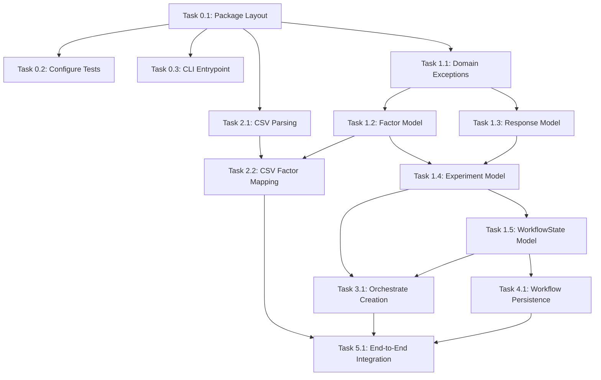

# DOE Python Core — Implementation Task List (Minimal Milestone)

This document outlines the ordered implementation tasks for the first milestone of the DOE Python Core project, based on the requirements and steps defined in `specs/plan1.md`.

---

## Task List Diagram

---

## Step 0 — Project Scaffolding

### Task 0.1: Package Directory and Layout Scaffolding
- **Description:** Set up the physical file structure under the `doe/` directory:
  - `doe/`
  - `doe/models/`
  - `doe/imports/`
  - `tests/`
- **Dependencies:** None
- **Acceptance Criteria:**
  - Directory structure is present.
  - Subdirectories are valid Python namespaces (with empty `__init__.py` files if needed).
  - Can import package in Python shell without errors: `import doe`.

### Task 0.2: Configure Test Framework and Execution
- **Description:** Set up the testing layout using a standard testing framework (e.g., `pytest`) and write a simple placeholder test in `tests/test_placeholder.py`.
- **Dependencies:** Task 0.1
- **Acceptance Criteria:**
  - Test command (e.g., `pytest`) runs without error and discovers the placeholder test.
  - Placeholder test passes successfully.

### Task 0.3: Create CLI Entrypoint
- **Description:** Create the main module `doe/main.py` with a simple entrypoint placeholder.
- **Dependencies:** Task 0.1
- **Acceptance Criteria:**
  - Running `python -m doe.main` completes without throwing module or syntax errors.

---

## Step 1 — Domain Models

### Task 1.1: Implement Domain Exception Classes
- **Description:** Define specific domain validation exception classes (e.g., in a new file `doe/models/exceptions.py` or separate files matching models):
  - Factor-related: `InvalidFactorTypeError`, `InvalidFactorBoundsError`, `MissingFactorLevelsError`, `DuplicateFactorLevelsError`
  - Response-related: `MissingResponseError`, `InvalidResponseTypeError`
  - Experiment-related: `DuplicateFactorNameError`, `InvalidDesignTypeError`, `InvalidPlannedRunsError`
- **Dependencies:** Task 0.1
- **Acceptance Criteria:**
  - All classes are importable and inherit from a base `DoeDomainError` or similar custom exception.

### Task 1.2: Implement `Factor` Domain Model
- **Description:** Create `doe/models/factor.py` defining the `Factor` dataclass.
- **Dependencies:** Task 1.1
- **Acceptance Criteria:**
  - Supports fields: `name`, `type`, `unit`, `levels`, `lower_bound`, `upper_bound`, `metadata`, and `schema_version`.
  - Implements `validate()`, raising:
    - `InvalidFactorTypeError` if type is not `continuous` or `categorical`.
    - `InvalidFactorBoundsError` if `continuous` and bounds are missing or lower_bound $\ge$ upper_bound.
    - `MissingFactorLevelsError` if `categorical` and `levels` is missing.
    - `DuplicateFactorLevelsError` if `categorical` levels contain duplicates or $< 2$ distinct values.
  - Implements `to_dict()` and `from_dict()` for JSON serialization/deserialization.

### Task 1.3: Implement `Response` Domain Model
- **Description:** Create `doe/models/response.py` defining the `Response` dataclass.
- **Dependencies:** Task 1.1
- **Acceptance Criteria:**
  - Supports fields: `name`, `type`, `unit`, `metadata`, and `schema_version`.
  - Implements `validate()`, raising:
    - `InvalidResponseTypeError` if type is not `continuous` (for the MVP).
    - `MissingResponseError` if name is empty.
  - Implements `to_dict()` and `from_dict()` for serialization.

### Task 1.4: Implement `Experiment` Domain Model
- **Description:** Create `doe/models/experiment.py` defining the `Experiment` dataclass.
- **Dependencies:** Task 1.2, Task 1.3
- **Acceptance Criteria:**
  - Supports fields: `schema_version`, `experiment_id` (system-generated, unique), `name`, `description`, `factors`, `responses`, `design_type`, `planned_runs`, and `metadata`.
  - Implements `validate()`, raising:
    - Validation error if factors or responses list is empty.
    - `DuplicateFactorNameError` if factor names are not unique.
    - `InvalidDesignTypeError` if `design_type` is not supported (only `full_factorial` and `fractional_factorial` in MVP).
    - `InvalidPlannedRunsError` if `planned_runs` is present but is not a positive integer.
  - Verification that it does not contain runs, results, or analysis.
  - Implements `to_dict()` and `from_dict()` for nested serialization.

### Task 1.5: Implement `WorkflowState` Domain Model
- **Description:** Create `doe/models/workflow_state.py` defining the `WorkflowState` dataclass.
- **Dependencies:** Task 1.4
- **Acceptance Criteria:**
  - Supports fields: `schema_version`, `step`, `experiment`, `design`, `results`, `analysis`, and `audit`.
  - `design`, `results`, and `analysis` default/remain `null` for this milestone.
  - `validate()` checks consistency between `step` state and nested objects.
  - `to_dict()` and `from_dict()` handle nested serialization.

---

## Step 2 — CSV Import for Factors

### Task 2.1: Implement CSV Parsing Logic
- **Description:** Create `doe/imports/csv_factor_importer.py` to parse raw factor definitions from a CSV source.
- **Dependencies:** Task 0.1
- **Acceptance Criteria:**
  - Correctly parses headers and rows into dictionaries.
  - Raises standard exceptions (e.g. `CsvFormatError` or `CsvHeaderError`) if the CSV is malformed or headers are incorrect.

### Task 2.2: Map Raw Rows to Factor Objects with Error Collection
- **Description:** Implement mapping function from raw CSV rows to `Factor` dataclass instances.
- **Dependencies:** Task 2.1, Task 1.2
- **Acceptance Criteria:**
  - Success path returns list of valid `Factor` objects.
  - Failure path aggregates validation errors and raises `CsvRowImportError` detailing the row number, field name, and invalid value.

---

## Step 3 — Create Experiment

### Task 3.1: Orchestrate Experiment Creation Function
- **Description:** Create the workflow creation function `create_experiment()` inside `doe/experiment_creation.py`.
- **Dependencies:** Task 1.4, Task 1.5
- **Acceptance Criteria:**
  - Accepts experiment details: name, description, factors list, responses list, design type.
  - Returns an updated `WorkflowState` object with `step = "experiment_created"`.
  - Rejects invalid configurations by raising the appropriate domain exceptions.

---

## Step 4 — Minimal WorkflowState

### Task 4.1: Implement JSON Save/Load Persistence
- **Description:** Implement utility functions (in `doe/models/workflow_state.py` or separate persistence helper) to write and read `WorkflowState` to/from JSON files.
- **Dependencies:** Task 1.5
- **Acceptance Criteria:**
  - State can be written to a target JSON file.
  - State can be read back from the JSON file.
  - A round-trip operation results in an object that matches the original state exactly.

---

## Step 5 — First End-to-End Test

### Task 5.1: Create E2E Integration Test
- **Description:** Implement integration test in `tests/` verifying the entire minimal pipeline.
- **Dependencies:** Task 2.2, Task 3.1, Task 4.1
- **Acceptance Criteria:**
  - Test loads a sample factor CSV file.
  - Parses and validates factors.
  - Successfully creates a valid `Experiment` object.
  - Saves the resulting `WorkflowState` to a JSON file.
  - Reloads the state from the JSON file and confirms it is correct and complete.
  - All tests execute and pass.
