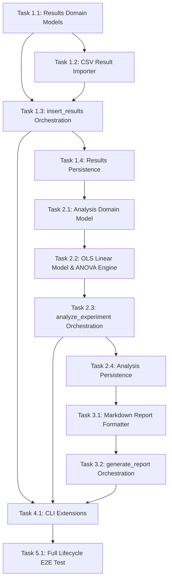

# DOE Python Core — Implementation Task List (Completion Milestone)

This document outlines the ordered implementation tasks for the final milestone (Part 3) of the DOE Python Core project, based on `specs/technical_spec.md` and building upon `specs/implementation_tasks_1.md` and `specs/implementation_tasks_2.md`.

---

## Current implementation status

### What is completed
- **Core Domain Models**: `Factor`, `Response`, `Experiment`, `Run`, `Block`, `Design`, and `WorkflowState` are fully implemented with dataclasses, validations, and `to_dict()`/`from_dict()` serialization.
- **Domain Exceptions**: Comprehensive exception hierarchy in `doe/models/exceptions.py` covering validation, workflow, design/results, analysis, and CSV errors.
- **CSV Factor Import**: `csv_factor_importer.py` parses factor definitions from CSV with row-level error reporting (`CsvRowImportError`).
- **Design Generation**: `DesignGenerator` interface and `FullFactorialGenerator` supporting combinations of continuous and categorical factors.
- **Workflow Operations**: `create_experiment()` and `generate_design()` operations managing state transitions (`empty -> experiment_created -> design_generated`).
- **Workflow Persistence**: JSON serialization and deserialization routines for `WorkflowState` including `Experiment` and `Design`.
- **CLI Commands**: CLI entrypoint (`doe/main.py`) with subcommands to create experiments (from CSV) and generate designs.
- **Testing**: Test suite covering factor/response/experiment validation, run/block/design models, full factorial matrix generation, workflow state transitions, persistence round-trips, and CLI integration.

### What is partially completed
- **WorkflowState Machine**: `WorkflowState` model and transition logic are established for early steps (`experiment_created`, `design_generated`), but lack support for downstream steps (`results_in_progress`, `results_complete`, `analysis_created`, `report_generated`).
- **Domain Exceptions**: Exception classes for result entry, analysis, and reporting are already defined in `doe/models/exceptions.py`, but the corresponding domain logic and workflow functions are not yet using them.
- **CLI Subcommands**: CLI architecture exists with argument parsing, but lacks subcommands for result insertion, analysis computation, report generation, and workflow status inspection.

### What is still missing
- **Result Domain Models**: `ResultEntry` and `Results` models for capturing experimental measurements and tracking completion status.
- **Result Import & Insertion**: CSV result importer (`doe/imports/csv_result_importer.py`) and `insert_results()` workflow function.
- **Statistical Analysis Engine**: `Analysis` domain model, Ordinary Least Squares (OLS) linear model solver, ANOVA table computation, R² metrics, p-values, residual calculations, and `analyze_experiment()` workflow orchestration.
- **Report Generation**: Markdown report generator (`doe/report_generation.py`) producing structured summary reports from `WorkflowState`, and `generate_report()` workflow operation.
- **CLI Handoff & Subcommands**: CLI subcommands (`insert-results`, `analyze`, `report`, `status`) to expose the complete pipeline from CLI.
- **End-to-End Workflow Integration Test**: Full lifecycle integration test covering CSV factor import -> Experiment -> Design -> CSV result import -> Analysis -> Markdown report -> JSON persistence.

---

## Task List Diagram

---

# Part 3 - Implementation Plan

## Step 1 — Result Collection & Domain Models

### Task 1.1: Implement `ResultEntry` and `Results` Domain Models

#### Description
Create the result domain models to represent experimental observations associated with runs in a design. `ResultEntry` represents the outcome of an individual run, while `Results` acts as the aggregate container for all entries in a design, tracking overall completeness (`partial` vs `complete`).

#### Dependencies
- Completed domain models (`Run`, `Response`, `Design`)
- Exception classes in `doe/models/exceptions.py`

#### Acceptance Criteria
- `ResultEntry` fields: `run_ref` (str), `values` (dict[str, Any]), `status` (`partial` | `complete`), `metadata` (dict | null).
- `ResultEntry.validate()` verifies `run_ref` is present, `values` is non-empty, and `status` is valid.
- `Results` fields: `schema_version` (str), `results_id` (str), `design_ref` (str), `entries` (list[ResultEntry]), `completeness` (`partial` | `complete`), `metadata` (dict | null).
- `Results.validate()` verifies:
  - `results_id` and `design_ref` are non-empty;
  - every `ResultEntry` in `entries` is valid;
  - `completeness` is set to `complete` only when all runs in the referenced design have complete response values, and `partial` otherwise.
- Both models implement `to_dict()` and `from_dict()` methods.

#### Expected implementation changes
- Create `doe/models/results.py` containing `ResultEntry` and `Results` dataclasses.
- Update `doe/models/__init__.py` to export `ResultEntry` and `Results`.

#### Tests required
- `tests/test_results.py`: Unit tests for `ResultEntry` and `Results` instantiation, validation (valid/invalid status, missing fields), serialization round-trips (`to_dict`/`from_dict`).

---

### Task 1.2: Implement CSV Result Importer

#### Description
Implement a CSV result importer to parse measurement data from an external CSV file, mapping raw columns to run references (`run_ref` or `run_id`) and response variable values.

#### Dependencies
- Task 1.1
- CSV import exception classes (`CsvHeaderError`, `CsvRowImportError`)

#### Acceptance Criteria
- Parses CSV files containing `run_id` (or `run_ref`) and response column headers.
- Converts raw string values into numeric types (float/int) matching response factor expectations.
- Returns a list of `ResultEntry` objects.
- Raises `CsvHeaderError` if required run reference or response columns are missing.
- Raises `CsvRowImportError` (with row number, column name, and invalid value) when parsing fails for a specific cell.

#### Expected implementation changes
- Create `doe/imports/csv_result_importer.py` with `import_results_from_csv(file_path_or_stream, design, responses)`.
- Update `doe/imports/__init__.py` to export the importer.

#### Tests required
- `tests/test_csv_result_importer.py`: Tests for parsing valid result CSVs, type conversion, missing column handling, and row-level import error reporting.

---

### Task 1.3: Implement `insert_results()` Workflow Function

#### Description
Orchestrate result insertion into the experiment workflow. The `insert_results()` function accepts a `WorkflowState` and result data, validates references against the existing `Design` and `Experiment`, creates or updates the `Results` aggregate, and updates the workflow step.

#### Dependencies
- Task 1.1
- Task 1.2
- `WorkflowState` model and `doe/design_generation.py` transition patterns

#### Acceptance Criteria
- Accepts `WorkflowState` (must be in step `design_generated` or `results_in_progress`) and result payload/entries.
- Validates that:
  - `WorkflowState` contains a valid `Design`;
  - every `run_ref` in inserted results corresponds to an existing `Run.run_id` in `Design` (raises `UnknownRunIdError` if not);
  - response values match defined `Response` types (raises `InvalidResponseValueError` if invalid);
  - duplicate results for the same run are handled or rejected (`DuplicateResultForRunError`).
- Updates `WorkflowState.results` with the `Results` object.
- Transitions `WorkflowState.step` to `results_in_progress` (if partial) or `results_complete` (if all runs have complete measurements).

#### Expected implementation changes
- Create `doe/result_input.py` containing `insert_results(state, result_entries)`.
- Update `WorkflowState.validate()` in `doe/models/workflow_state.py` to allow `results_in_progress` and `results_complete` steps.

#### Tests required
- `tests/test_result_input.py`: Unit tests for `insert_results()` verifying valid insertions, partial vs complete status updates, unknown run ID rejection, invalid response value rejection, and workflow state transitions.

---

### Task 1.4: Extend `WorkflowState` Persistence for Results

#### Description
Extend `WorkflowState` serialization and deserialization to support saving and restoring states containing `Results`.

#### Dependencies
- Task 1.3

#### Acceptance Criteria
- `WorkflowState.to_dict()` includes the `results` dictionary when present.
- `WorkflowState.from_dict()` reinstantiates the nested `Results` object (and its `ResultEntry` list).
- `save_workflow_state()` and `load_workflow_state()` preserve results accurately across JSON round-trips.

#### Expected implementation changes
- Update `doe/models/workflow_state.py` to serialize and deserialize the `results` field.

#### Tests required
- `tests/test_persistence.py`: Add test cases for round-trip JSON serialization of `WorkflowState` containing `results`.

---

## Step 2 — Statistical Analysis Engine

### Task 2.1: Implement `Analysis` Domain Model

#### Description
Create the `Analysis` domain model representing the statistical analysis output of an experiment, including model coefficients, ANOVA table, summary statistics ($R^2$, adjusted $R^2$), residuals, and model diagnostics.

#### Dependencies
- Exception classes in `doe/models/exceptions.py`

#### Acceptance Criteria
- Fields: `schema_version` (str), `analysis_id` (str), `model_type` (str, default `"linear"`), `experiment_ref` (str), `design_ref` (str), `results_ref` (str), `coefficients` (dict[str, float] | null), `anova_table` (list[dict[str, Any]] | null), `p_values` (dict[str, float] | null), `r_squared` (float | null), `adjusted_r_squared` (float | null), `residuals` (list[float] | null), `diagnostics` (dict[str, Any] | null), `metadata` (dict | null).
- `Analysis.validate()` verifies:
  - required ID and reference fields are present;
  - `r_squared` and `adjusted_r_squared`, if present, are in the range $[0.0, 1.0]$.
- Implements `to_dict()` and `from_dict()` for JSON serialization.

#### Expected implementation changes
- Create `doe/models/analysis.py` defining the `Analysis` dataclass.
- Update `doe/models/__init__.py` to export `Analysis`.

#### Tests required
- `tests/test_analysis_model.py`: Unit tests for `Analysis` validation, $R^2$ bound enforcement, and `to_dict`/`from_dict` serialization.

---

### Task 2.2: Implement OLS Linear Model & ANOVA Engine

#### Description
Implement the core statistical computational engine for linear model estimation using Ordinary Least Squares (OLS). The engine constructs the design matrix $X$ from runs and factor levels, forms the response vector $Y$, solves for coefficients $\hat{\beta} = (X^T X)^{-1} X^T Y$, computes fitted values, residuals, sum of squares (SSR, SSE, SST), degrees of freedom, mean squares, F-statistic, p-values, $R^2$, and adjusted $R^2$.

#### Dependencies
- Task 2.1
- Domain exceptions (`InsufficientObservationsError`, `NonEstimableModelError`, `InvalidAnalysisInputError`)

#### Acceptance Criteria
- Constructs the full design matrix $X$ (including intercept column and main effect terms for continuous and categorical factors).
- Checks for matrix rank deficiency and sufficient degrees of freedom:
  - Raises `InsufficientObservationsError` if number of observations $N \le$ number of model parameters $p$;
  - Raises `NonEstimableModelError` if matrix $X^T X$ is singular / non-invertible.
- Calculates:
  - `coefficients`: mapping parameter names (e.g. `Intercept`, factor names) to estimated coefficients $\hat{\beta}$;
  - `anova_table`: list of rows for Model, Residuals, Total with Sum of Squares (SS), Degrees of Freedom (DF), Mean Squares (MS), F-value, and P-value;
  - `p_values`: mapping parameter names to two-tailed t-test p-values;
  - `r_squared` ($R^2$) and `adjusted_r_squared` ($R^2_{adj}$);
  - `residuals`: vector of observed minus predicted values ($e = Y - \hat{Y}$).
- Uses pure Python / standard library math or numpy if available without introducing heavy unnecessary frameworks.

#### Expected implementation changes
- Create `doe/analysis_computation.py` (or `doe/analysis/linear_model.py`) containing `fit_linear_model(experiment, design, results)`.

#### Tests required
- `tests/test_analysis_computation.py`: Unit tests comparing OLS results (coefficients, $R^2$, ANOVA values) against known analytical benchmarks, testing singular matrix handling, and testing insufficient data error handling.

---

### Task 2.3: Implement `analyze_experiment()` Workflow Function

#### Description
Orchestrate the statistical analysis step within the workflow state machine. The `analyze_experiment()` function checks preconditions, triggers model fitting, packages results into an `Analysis` domain object, and advances the workflow state.

#### Dependencies
- Task 2.1
- Task 2.2

#### Acceptance Criteria
- Accepts a `WorkflowState` (must be in step `results_complete`).
- Verifies referential consistency between `Experiment.experiment_id`, `Design.design_id`, and `Results.results_id` (raises `InconsistentReferenceError` if inconsistent).
- Calls the linear model fitting engine.
- Updates `WorkflowState.analysis` with the created `Analysis` object.
- Transitions `WorkflowState.step` to `analysis_created`.

#### Expected implementation changes
- Implement `analyze_experiment(state)` in `doe/analysis_computation.py`.
- Update `WorkflowState.validate()` to allow step `analysis_created`.

#### Tests required
- `tests/test_analyze_workflow.py`: Integration tests for `analyze_experiment()` verifying valid execution, state transition to `analysis_created`, and error handling for missing/incomplete results or reference mismatches.

---

### Task 2.4: Extend `WorkflowState` Persistence for Analysis

#### Description
Extend `WorkflowState` JSON serialization to support persisting and reloading states containing `Analysis`.

#### Dependencies
- Task 2.3

#### Acceptance Criteria
- `WorkflowState.to_dict()` includes the `analysis` dictionary when present.
- `WorkflowState.from_dict()` reinstantiates the nested `Analysis` object.
- JSON save/load operations preserve all analysis metrics (coefficients, ANOVA table, $R^2$, p-values, residuals) across round-trips.

#### Expected implementation changes
- Update `doe/models/workflow_state.py` to serialize and deserialize the `analysis` field.

#### Tests required
- `tests/test_persistence.py`: Test case for round-trip JSON serialization of `WorkflowState` containing an `Analysis` object.

---

## Step 3 — Report Generation

### Task 3.1: Implement Markdown Report Formatter

#### Description
Implement a report formatter module that formats `WorkflowState` data into a clear, publication-ready Markdown report. The report includes sections for Experiment Overview, Factor & Response Specifications, Design Matrix & Run Table, Experimental Results, and Statistical Analysis Summary (ANOVA table, coefficients, R² metrics).

#### Dependencies
- Task 2.3

#### Acceptance Criteria
- Generates a formatted Markdown string.
- Sections included based on workflow state completeness:
  - **Experiment Overview**: Name, description, design type, schema version;
  - **Factors & Responses**: Summary tables of inputs and output variables;
  - **Design Matrix**: Executed runs table;
  - **Results Summary**: Measured response values per run;
  - **Statistical Analysis**: Coefficients table (estimates, std errors, p-values), ANOVA table, model fit ($R^2$, $R^2_{adj}$).
- Handles earlier workflow states gracefully (e.g. generating a design-only report if results/analysis are not yet present).

#### Expected implementation changes
- Create `doe/report_generation.py` containing `format_markdown_report(state)`.

#### Tests required
- `tests/test_report_generation.py`: Unit tests for report formatting across different workflow steps (`experiment_created`, `design_generated`, `results_complete`, `analysis_created`), ensuring all expected headers and data tables are generated.

---

### Task 3.2: Implement `generate_report()` Workflow Function

#### Description
Orchestrate report generation as a workflow function, creating the formatted report and optionally saving it to an output file.

#### Dependencies
- Task 3.1

#### Acceptance Criteria
- Accepts `WorkflowState` and target output path (or format string, default `"markdown"`).
- Produces and writes the report file to disk.
- Updates `WorkflowState.step` to `report_generated` (if export tracking is enabled).
- Raises appropriate error if state contains insufficient data (e.g., missing experiment).

#### Expected implementation changes
- Implement `generate_report(state, output_path=None, format="markdown")` in `doe/report_generation.py`.
- Update `WorkflowState.validate()` to allow `report_generated` step.

#### Tests required
- `tests/test_report_workflow.py`: Tests for `generate_report()` execution, file output writing, and state updating.

---

## Step 4 — Complete CLI Interface & Commands

### Task 4.1: Implement CLI Commands for Results, Analysis, and Reporting

#### Description
Extend the CLI entrypoint (`doe/main.py`) to expose subcommands for the remaining workflow operations: importing/inserting results, running statistical analysis, generating reports, and checking workflow state.

#### Dependencies
- Task 1.3
- Task 2.3
- Task 3.2

#### Acceptance Criteria
- Subcommand `insert-results`:
  - Arguments: `--state <path>`, `--csv <path>`, `--output <path>` (optional, defaults to overwriting state);
  - Loads workflow state, imports results from CSV, executes `insert_results()`, saves updated state.
- Subcommand `analyze`:
  - Arguments: `--state <path>`, `--output <path>`;
  - Loads workflow state, executes `analyze_experiment()`, saves updated state.
- Subcommand `report`:
  - Arguments: `--state <path>`, `--out <path>` (e.g., `report.md`), `--format <markdown|json>`;
  - Loads workflow state, calls `generate_report()`, writes report file.
- Subcommand `status`:
  - Arguments: `--state <path>`;
  - Prints human-readable summary of current workflow step, experiment name, design run count, results completion status, and analysis status.
- CLI exits with code 0 on success and non-zero on domain/workflow errors with descriptive error messages.

#### Expected implementation changes
- Update `doe/main.py` with argument parsers and command handlers for `insert-results`, `analyze`, `report`, and `status`.

#### Tests required
- `tests/test_cli_completion.py`: CLI integration tests simulating command-line invocations of `insert-results`, `analyze`, `report`, and `status`, verifying output files and exit codes.

---

## Step 5 — Full End-to-End Integration Test

### Task 5.1: Create Full Lifecycle E2E Integration Test

#### Description
Implement a comprehensive end-to-end integration test validating the entire DOE Python Core workflow from factor CSV import to Markdown report output.

#### Dependencies
- Tasks 1.1 through 4.1

#### Acceptance Criteria
- Test executes the complete workflow sequentially:
  1. Parse factor definitions from a sample CSV file;
  2. Create an `Experiment` (`create_experiment()`);
  3. Generate a `FullFactorial` design (`generate_design()`);
  4. Save `WorkflowState` to JSON;
  5. Import response measurements from a result CSV file and insert results (`insert_results()`);
  6. Compute linear model statistical analysis (`analyze_experiment()`);
  7. Confirm ANOVA table, coefficients, and $R^2$ are computed accurately;
  8. Save final `WorkflowState` to JSON and reload it;
  9. Generate Markdown report (`generate_report()`) and confirm report file content;
  10. Confirm all intermediate and final workflow state JSON files pass validation and round-trip equality checks.

#### Expected implementation changes
- Create `tests/test_e2e_full_workflow.py`.

#### Tests required
- Run `pytest` across the full test suite to guarantee 100% pass rate.

---

## Out of Scope for this milestone

- Database / SQL persistence (JSON workflow state remains the source of truth).
- Non-linear regression models (logistic regression, response surface polynomial fitting beyond standard linear interaction models).
- Graphical User Interface (GUI) or web dashboard.
- Advanced fractional factorial generation algorithms or optimal experimental designs (D-optimal, A-optimal).
- Real-time hardware integration for automated experimental result streaming.

---

## Completion Rule

The DOE Python Core project MVP is considered COMPLETE when:

- all unit tests for domain models (`Factor`, `Response`, `Experiment`, `Run`, `Block`, `Design`, `ResultEntry`, `Results`, `Analysis`, `WorkflowState`) pass;
- all workflow operation tests (`create_experiment`, `generate_design`, `insert_results`, `analyze_experiment`, `generate_report`) pass;
- JSON state persistence round-trip tests pass across all workflow steps;
- CLI commands (`create-experiment`, `generate-design`, `insert-results`, `analyze`, `report`, `status`) execute cleanly;
- the full lifecycle end-to-end integration test (`test_e2e_full_workflow.py`) executes and passes successfully.
