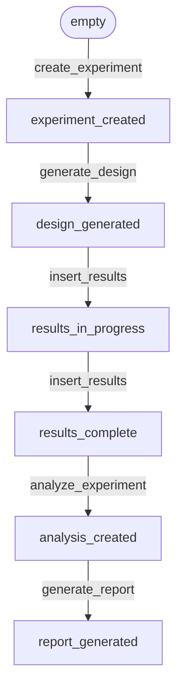

 DOE Core Technical Specification Knowledge Base

This document provides a structured, precise summary of the Python core for the DOE (Design of Experiments) project based on `specs/technical_spec.md`. It outlines the architectural principles, domain models, workflows, binding rules, and lists key ambiguities, conflicts, and open decisions.

---

## 1. Architectural Decisions & Principles

- **Separation of Concerns:** Distinct modules manage data definitions, algorithm generation, orchestration, and reporting.
- **Design by Contract:** Every model and function enforces explicit preconditions, postconditions, and invariants.
- **Domain-First Architecture:** Lightweight domain models (`dataclasses`) contain local validation and serialization, but *no* algorithms or workflow orchestration.
- **Algorithm Independence:** DOE algorithms (e.g., design generators) are separated from models and orchestration layer.
- **Workflow State Persistence:** System steps are stateless, communicating via a JSON-serializable `WorkflowState` which serves as the single source of truth.
- **Referential Integrity:** 
  - System-generated IDs (`*_id`) are the authoritative unique references.
  - Ref fields (`*_ref`) must resolve to these IDs.
  - User-provided names are descriptive only and are not used as references.

---

## 2. Domain Models & Binding Invariants

All models must implement: `schema_version: str`, `validate() -> None`, `to_dict() -> dict`, and `from_dict(data: dict) -> Model`. Serialization uses JSON-compatible types only.

### 2.1 Factor
- **Fields:** `name` (str), `type` (FactorType), `unit` (str | null), `levels` (list[Any] | null), `lower_bound` (float | null), `upper_bound` (float | null), `metadata` (dict[str, Any] | null)
- **Supported Types:** `continuous`, `categorical`
- **Invariants:**
  - `name` is required, non-empty, and unique within the `Experiment`.
  - `type` is required and supported.
  - If `type == continuous`: `lower_bound` and `upper_bound` are required; `lower_bound < upper_bound`.
  - If `type == categorical`: `levels` is required and contains $\ge 2$ distinct values.
  - Cannot be both continuous and categorical.

### 2.2 Response
- **Fields:** `name` (str), `type` (ResponseType), `unit` (str | null), `metadata` (dict[str, Any] | null)
- **Supported Types:** `continuous` (for MVP)
- **Invariants:**
  - `name` is required and non-empty.
  - `type` is required and supported.
  - `unit`, if present, is non-empty.

### 2.3 Experiment
- **Fields:** `schema_version` (str), `experiment_id` (str, system-generated, unique), `name` (str), `description` (str | null), `factors` (list[Factor]), `responses` (list[Response]), `design_type` (DesignType), `planned_runs` (int | null), `metadata` (dict[str, Any] | null)
- **Supported Designs:** `full_factorial`, `fractional_factorial`
- **Invariants:**
  - $\ge 1$ factor, $\ge 1$ response.
  - Factor and response names are unique.
  - `planned_runs`, if present, must be a positive integer $\ge$ minimum required runs for the `design_type`.
  - Must not contain runs, results, or analysis.

### 2.4 Run
- **Fields:** `run_id` (str, system-generated, unique within design), `factor_values` (dict[str, Any]), `metadata` (dict[str, Any] | null)
- **Invariants:**
  - `factor_values` contains all factors required by the experiment.
  - Values must comply with factor type constraints.

### 2.5 Design
- **Fields:** `schema_version` (str), `design_id` (str, system-generated), `design_type` (DesignType), `experiment_ref` (str), `runs` (list[Run]), `randomization` (bool), `order` (list[str] | null), `blocks` (list[Block] | null), `replications` (int | null), `metadata` (dict[str, Any] | null)
- **Invariants:**
  - $\ge 1$ run; unique run IDs.
  - Every run contains all factors required by the experiment.
  - `design_type` and run count are consistent with the referenced experiment.
  - `order`, if present, must be a permutation of `run_id`s in `runs` (automatically generated when randomization is enabled).
  - Must not contain results or analysis.

### 2.6 Block (Optional for MVP)
- **Fields:** `block_id` (str, unique within design), `run_ids` (list[str]), `metadata` (dict[str, Any] | null)
- **Invariants:**
  - `run_ids` contains valid `Run.run_id` values from the same design.
  - Each `run_id` belongs to at most one block.

### 2.7 ResultEntry & Results
- **ResultEntry Fields:** `run_ref` (str), `values` (dict[str, Any]), `status` (ResultStatus: `partial` or `complete`), `metadata` (dict[str, Any] | null)
  - *Invariant:* `status = complete` only if all required responses are present.
- **Results Fields:** `schema_version` (str), `results_id` (str), `design_ref` (str), `entries` (list[ResultEntry]), `completeness` (ResultStatus), `metadata` (dict[str, Any] | null)
  - *Invariants:* `design_ref` references a valid `design_id`. All entry `run_ref`s exist in the design. Partial results are allowed.

### 2.8 Analysis
- **Fields:** `schema_version` (str), `analysis_id` (str), `model_type` (str), `experiment_ref` (str), `design_ref` (str), `results_ref` (str), `coefficients` (dict[str, float] | null), `anova_table` (list[dict[str, Any]] | null), `p_values` (dict[str, float] | null), `r_squared` (float | null), `adjusted_r_squared` (float | null), `residuals` (list[float] | null), `diagnostics` (dict[str, Any] | null), `metadata` (dict[str, Any] | null)
- **Invariants:**
  - References to experiment, design, and results must be consistent.
  - `r_squared` and `adjusted_r_squared` must be $\in [0, 1]$.
  - Analysis is produced only if the model is estimable.
  - The model type is fixed to a linear model for the MVP.

### 2.9 WorkflowState
- **Fields:** `schema_version` (str), `step` (WorkflowStep), `experiment` (Experiment | null), `design` (Design | null), `results` (Results | null), `analysis` (Analysis | null), `audit` (dict[str, Any])

---

## 3. Workflow Steps & State Transitions

Transitions are monotonic, explicit, and controlled:


### Monotonicity Rules:
- No backward state transitions are allowed without an explicit migration.
- `WorkflowState` objects must remain JSON-serializable after each transition.

---

## 4. File Structure & Module Responsibilities

```
doe/
├── main.py                     # Entry point / CLI orchestrator
├── experiment_creation.py      # Workflow orchestration & validation for experiment
├── design_generation.py        # Workflow orchestration & validation for design
├── result_input.py             # Workflow orchestration & validation for results
├── analysis_computation.py     # Workflow orchestration & validation for analysis
├── report_generation.py        # Workflow orchestration & validation for reports
├── models/                     # Data definitions, local validation, serialization
│   ├── factor.py
│   ├── response.py
│   ├── experiment.py
│   ├── design.py               # Also contains Block and Run models
│   ├── results.py              # Also contains ResultEntry model
│   ├── analysis.py
│   └── workflow_state.py
└── designs/                    # Algorithm generators
    ├── full_factorial.py       # Full factorial matrix generation
    └── fractional_factorial.py # Fractional factorial matrix generation
tests/                          # Unit, contract, serialization, and integration tests
```

---

## 5. Ambiguities, Conflicts, and Incomplete Requirements

The following details are either missing or potentially contradictory in the specification and must be resolved before implementation:

| Domain Area | Description | Ambiguity / Conflict |
| :--- | :--- | :--- |
| **Factor Levels** | `levels: list[Any] | null` | What data types are allowed for levels? If numeric levels are provided, can they conflict with or lie outside `lower_bound` / `upper_bound`? |
| **Audit Log Schema** | `audit: dict[str, Any]` | The exact schema and required keys for the `audit` field in `WorkflowState` are completely undefined. |
| **Result State Transitions** | `design_generated -> results_in_progress -> results_complete` | If all results are imported at once (e.g., via CSV), can the state transition directly from `design_generated` to `results_complete`? |
| **CSV Parsing Errors** | Row-level import errors | Section 2.6 specifies row-level error details (row number, field name, invalid value), but Section 6 (Errors) lists no specific CSV validation error classes (e.g., `CSVRowParsingError`). |
| **Planned Runs Consistency** | `planned_runs` vs. generator output | If `planned_runs` is defined in an `Experiment`, does the generator enforce this exact number of runs, or is it merely validated against a minimum limit? If a full factorial design requires 8 runs but `planned_runs = 10`, is this an error? |
| **Report Step Exclusivity** | `optional step = report_generated` | Section 4.5 says transitioning to `report_generated` is optional. However, Section 5 lists `analysis_created -> report_generated` as a standard step. It's unclear if the workflow state remains at `analysis_created` if export tracking is omitted. |
| **Randomization & Order** | `order: list[str] | null` | If randomization is disabled, should `order` be `null` or contain a default sequence of run IDs? How does the orchestrator parse and execute runs if `order` is `null`? |
| **Categorical Factor Coding** | Regression Coefficients | For analysis of categorical variables in the linear model, what coding scheme is expected (e.g., dummy coding, effect coding)? This determines the length and keys of `coefficients: dict[str, float]`. |
| **Estimability Criteria** | `NonEstimableModelError` | The exact conditions under which a linear model is defined as "non-estimable" (e.g., rank-deficient design matrix, fewer observations than terms) are not mathematically specified. |
